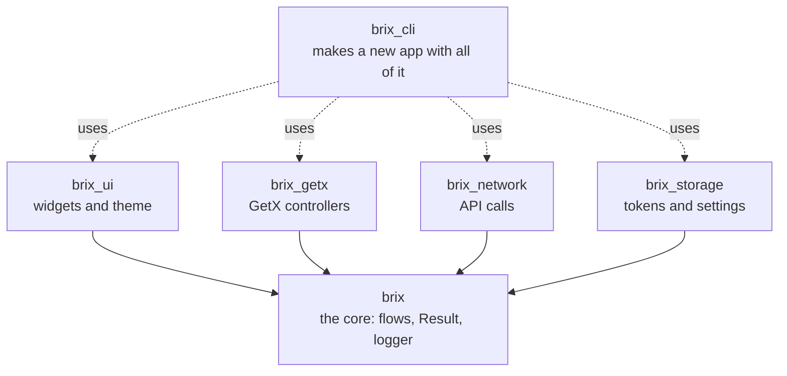
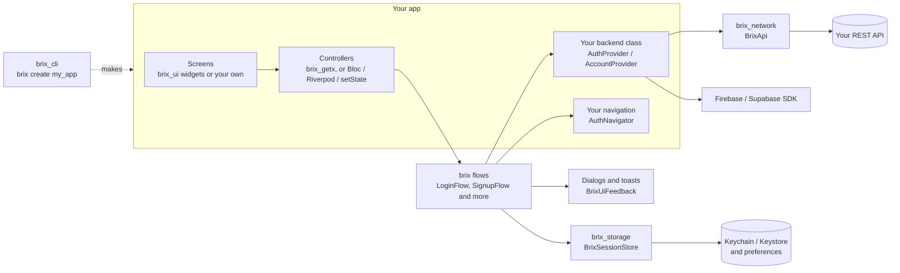

# brix

[](https://github.com/mrubaz/brix/actions/workflows/ci.yml)
[](https://pub.dev/packages/brix_cli)
[](https://pub.dev/packages/brix_ui)
[](https://pub.dev/packages/brix_getx)
[](https://pub.dev/packages/brix_network)
[](https://pub.dev/packages/brix_storage)
[](https://pub.dev/packages/brix)
[](LICENSE)

brix is a family of Flutter packages that gives every app the same tested start: account screens, API calls, safe storage and a widget kit that takes your brand. You skip the weeks of setup and begin with the screens that make your app different.


- **Any backend.** REST (Node, Laravel, Django, FastAPI and so on), Firebase or Supabase. You write one small class that talks to yours.
- **Any state library.** The logic is plain Dart. GetX controllers are ready; Riverpod, Bloc, Provider or `setState` need a few lines.
- **Your look.** Widgets take your colours, font and shape, in light and dark. Or use your own widgets.
- **Safe updates.** New features come with defaults, so a new version does not ask you to change your code.

## Start here

There are two ways in. Pick the one that fits you.

### A new app: use brix_cli

One command makes a working app with every screen wired.

```
dart pub global activate brix_cli
brix create my_app --org com.mycompany
cd my_app
flutter run
```

Until you add your API, debug runs use a test backend on the device: log in with `demo@brix.dev` and `Demo@1234`, every code is `123456`, or tap "Skip login". Put your API address in `lib/config/app_config.dart` when you are ready; release builds never contain the test backend. More in the [brix_cli README](packages/brix_cli).


### An app you already have: add what you need

| You want | Add |
|---|---|
| Ready widgets and a theme in your brand | [brix_ui](packages/brix_ui) |
| Login, signup, codes, reset and account screens with GetX | [brix_getx](packages/brix_getx) |
| API calls that return a result instead of throwing | [brix_network](packages/brix_network) |
| Tokens in the Keychain or Keystore, and settings | [brix_storage](packages/brix_storage) |
| The account logic only, with Riverpod, Bloc, Firebase or your own setup | [brix](packages/brix) |

```
flutter pub add brix_ui brix_getx brix_network brix_storage
```

Every package brings the core, `brix`, with it, so you never add it twice. The [brix_getx README](packages/brix_getx#add-brix-to-an-app-you-already-have) walks through the whole setup, from your API class to the first screen.

## The family



| Package | Version | What it does |
|---|---|---|
| [brix_cli](packages/brix_cli) | [](https://pub.dev/packages/brix_cli) | `brix create my_app` makes a new app on every package below. `brix id` changes the app id later. |
| [brix_ui](packages/brix_ui) | [](https://pub.dev/packages/brix_ui) | Buttons, text fields, select, sheets, dialogs, toasts and a loader that follow one theme, light and dark. |
| [brix_getx](packages/brix_getx) | [](https://pub.dev/packages/brix_getx) | A GetX controller for every account screen, so a screen is only its layout. |
| [brix_network](packages/brix_network) | [](https://pub.dev/packages/brix_network) | REST calls on Dio that return a `Result`: retries, uploads, downloads, one logout for many 401s, a readable log. |
| [brix_storage](packages/brix_storage) | [](https://pub.dev/packages/brix_storage) | Values and secrets (Keychain and Keystore), safe after a reinstall, and a ready session store. |
| [brix](packages/brix) | [](https://pub.dev/packages/brix) | The core every package builds on: login, signup, email code, reset, profile, delete account, app start and logout as plain Dart flows, plus `Result`, `Json` and `BrixLogger`. |

## What you get

- **Account:** login, signup, email codes with a resend timer, remember me, live password rules, forgot and reset password, change password.
- **Profile:** profile, avatar upload, delete account, app start and logout.
- **Network:** API calls, retries and timeouts, uploads, downloads, cancelling a call, backend messages and field errors, a readable log with secrets hidden.
- **Storage:** tokens in the Keychain or Keystore, settings, safe after a reinstall or a broken keystore.
- **UI:** buttons, text fields, code boxes, select, sheets, dialogs, toasts, a loader and panels.
- **Design:** one theme for colours, fonts, shapes, texts and icons, in light and dark, changed in one place or widget by widget.
- **Setup:** a new app in one command, a test backend for debug builds, the app id on every platform, and fakes for your tests.

## Screenshots

| | |
|---|---|
|  |  |
|  |  |
|  |  |

## How the pieces talk



You write a few small classes once: your user, the class for your API and your navigation. Storage, dialogs and the network setup come ready, and every flow uses them.

## Examples

| Example | What you see |
|---|---|
| [brix_cli app template](packages/brix_cli/templates/app) | The app `brix create` makes: every screen, a local test backend and tests |
| [brix_ui example](packages/brix_ui/example) | Every widget on one screen, light, dark and three brands |
| [GetX demo](packages/brix_getx/example) | Login, signup with a code, password reset and logout on a demo backend |
| [brix_network](packages/brix_network/example/main.dart) | Loading a list from a public API |
| [brix_storage](packages/brix_storage/example/main.dart) | Saving a value and a secret |
| [brix in plain Dart](packages/brix/example/main.dart) | A login without Flutter |

## Quality

- Every flow, controller, network piece and widget has tests.
- On every push, CI checks formatting, analysis and the tests of every package and example. It also creates a fresh app with `brix create`, runs its tests and checks that its release build holds no test accounts.
- brix runs in a live production app.
- The screenshots are made from the real widgets on an iPhone frame, not drawn by hand.
- MIT licensed.

## Working on brix

```
git clone https://github.com/mrubaz/brix.git
cd brix/packages/brix && dart pub get && dart test
```

Each package has its own `dart test` or `flutter test`. A `pubspec_overrides.yaml` in each package points it at the others in this repo, so they are built together.

Questions and ideas are welcome in the [issues](https://github.com/mrubaz/brix/issues).
