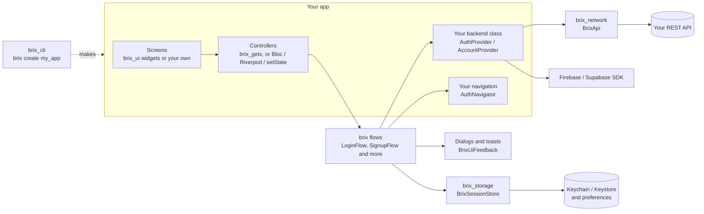

# brix

[](https://github.com/mrubaz/brix/actions/workflows/ci.yml)
[](https://pub.dev/packages/brix)
[](https://pub.dev/packages/brix_getx)
[](https://pub.dev/packages/brix_network)
[](https://pub.dev/packages/brix_storage)
[](https://pub.dev/packages/brix_ui)
[](https://pub.dev/packages/brix_cli)
[](LICENSE)

Most Flutter apps start with the same work: a login screen, signup with an email code, a forgot password flow, a profile page, API calls, saving the session and showing errors. brix does that part for you, so you can spend your time on the screens that make your app different.


- **Any backend.** REST (Node, Laravel, Django, FastAPI and so on), Firebase or Supabase. You write one small class that talks to yours.
- **Any state library.** The logic is plain Dart. GetX controllers are ready; Riverpod, Bloc, Provider or `setState` need a few lines.
- **Your look.** Ready widgets that take your colours, font and shape, in light and dark. Or use your own widgets.
- **Safe updates.** New features come with defaults, so a new version does not ask you to change your code.

## The packages

Take only what you need. Each one is its own package on pub.dev.

| Package | Version | What it does |
|---|---|---|
| [brix](packages/brix) | [](https://pub.dev/packages/brix) | The logic: login, signup, email code, password reset, profile, delete account, app start and logout. Also `Result`, `Json` and `BrixLogger`. Pure Dart. |
| [brix_getx](packages/brix_getx) | [](https://pub.dev/packages/brix_getx) | A GetX controller for every brix screen. |
| [brix_network](packages/brix_network) | [](https://pub.dev/packages/brix_network) | REST calls on Dio that return a `Result`. |
| [brix_storage](packages/brix_storage) | [](https://pub.dev/packages/brix_storage) | Values and secrets (Keychain and Keystore), and a ready session store. |
| [brix_ui](packages/brix_ui) | [](https://pub.dev/packages/brix_ui) | Buttons, text fields, select, dialogs, sheets, toasts and a loader, light and dark. |
| [brix_cli](packages/brix_cli) | [](https://pub.dev/packages/brix_cli) | `brix create my_app` makes a new app with all of the above wired. |

## Contents

- [Start a new app](#start-a-new-app)
- [Add brix to an app you already have](#add-brix-to-an-app-you-already-have)
- [Each package in short](#each-package-in-short)
- [How it fits together](#how-it-fits-together)
- [Examples](#examples)
- [Quality](#quality)

## Start a new app

The fastest way. One command makes a working app with every screen wired.

1. Install the command once:

   ```
   dart pub global activate brix_cli
   ```

2. Make your app (lowercase letters, digits and underscores):

   ```
   brix create my_app
   ```

3. Run it on the built-in test backend, no server needed:

   ```
   cd my_app
   flutter run -t lib/main_development.dart
   ```

   Log in with `demo@brix.dev` and `Demo@1234`. Every code is `123456`.

4. Point it at your API when you are ready:

   ```
   flutter run --dart-define=API_URL=https://your.api/v1/
   ```

You get login, signup with an email code, forgot and reset password, profile, change password, delete account and logout, in the folders of the [Flutter architecture guide](https://docs.flutter.dev/app-architecture/case-study). More in the [brix_cli README](packages/brix_cli).


## Add brix to an app you already have

This is the GetX and REST setup that `brix create` uses; every piece is taken from that app.

**1. Add the packages**

```
flutter pub add brix_getx brix_network brix_storage brix_ui
```

**2. Describe your user** (add the fields your API sends)

```dart
class User {
  const User({required this.id, required this.name, required this.email});

  factory User.fromJson(Json json) => User(
    id: json.string('id'),
    name: json.string('name'),
    email: json.string('email'),
  );

  final String id;
  final String name;
  final String email;

  Map<String, Object?> toJson() => {'id': id, 'name': name, 'email': email};
}
```

**3. Write the class that knows your API** (change the paths and fields to match yours)

```dart
class AuthRepository extends AuthProvider<SignupRequest, User> {
  AuthRepository(this._api);

  final BrixApi _api;

  @override
  AuthCapabilities get capabilities =>
      const AuthCapabilities(otpAfterSignup: true, resetMode: ResetMode.otp);

  @override
  Future<Result<AuthSession<User>>> login({
    required String identifier,
    required String password,
  }) => _api.post(
    'auth/login',
    body: {'email': identifier, 'password': password},
    parse: (data) => AuthSession(
      accessToken: data.string('token'),
      user: User.fromJson(data.child('user')),
    ),
  );

  @override
  Future<Result<void>> logout() => _api.post('auth/logout');

  // register, verifyOtp, resendOtp, forgotPassword and resetPassword
  // look the same: one call each.
}
```

**4. Say where screens go**

```dart
// Start the route and return; do not wait for the new screen to close.
class AppNavigator extends AuthNavigator {
  @override
  Future<void> toHome() async {
    Get.offAllNamed('/home');
  }

  @override
  Future<void> toLogin({String? identifier}) async {
    Get.offAllNamed('/login', arguments: identifier);
  }
}
```

**5. Set everything up once** (for example in `main`)

```dart
final session = BrixSessionStore<User>(
  storage: BrixStorage(), // tokens go to the Keychain / Keystore
  userToJson: (user) => user.toJson(),
  userFromJson: (json) => User.fromJson(Json(json)),
);

late final SessionFlow<User> sessionFlow;

final api = BrixApi(
  baseUrl: 'https://your.api/v1/',
  token: () async => (await session.readSession())?.accessToken,
  logger: PrettyNetworkLogger(),
  onUnauthorized: () => sessionFlow.logout(), // once, for many 401s
);

final auth = AuthRepository(api);
final navigator = AppNavigator();
const feedback = BrixUiFeedback(); // errors as dialogs, success as toasts

sessionFlow = SessionFlow(
  auth: auth,
  store: session,
  navigator: navigator,
  feedback: feedback,
);

BrixUi.navigatorKey = Get.key; // dialogs and toasts open from controllers
```

**6. Give the login screen its controller** (a GetX binding)

```dart
GetPage(
  name: '/login',
  page: () => const LoginScreen(),
  binding: BindingsBuilder(
    () => Get.put(
      BrixLoginController<User>(
        LoginFlow(
          provider: auth,
          store: session,
          navigator: navigator,
          feedback: feedback,
        ),
      ),
    ),
  ),
)
```

**7. Build the screen**

```dart
class LoginScreen extends GetView<BrixLoginController<User>> {
  const LoginScreen({super.key});

  @override
  Widget build(BuildContext context) => Scaffold(
    body: Form(
      key: controller.formKey,
      child: Column(
        children: [
          BrixTextField(
            controller: controller.identifierController,
            label: 'Email',
            isRequired: true,
          ),
          BrixTextField(
            controller: controller.passwordController,
            label: 'Password',
            isRequired: true,
            isPassword: true,
          ),
          Obx(
            () => BrixButton(
              label: 'Log in',
              isLoading: controller.isSubmitting.value,
              onPressed: controller.login,
            ),
          ),
        ],
      ),
    ),
  );
}
```

That is the whole login. Remember me, ignoring double taps, saving the session, showing errors and opening the home screen are handled. Signup, the email code, password reset, profile and delete account follow the same pattern; the [brix README](packages/brix) walks through each one.

Using Firebase, Supabase or another state library? Add only `brix` and follow the [brix README](packages/brix).

## Each package in short

### brix

The core. Every flow your app needs before its first real screen:

| Flow | What it does |
|---|---|
| `LoginFlow` | login, remember me, filling in the email again |
| `SignupFlow` | signup with your own fields and password rules |
| `OtpVerificationFlow` | the email code after signup, paste and autofill, resend countdown |
| `ForgotPasswordFlow`, `ResetPasswordFlow` | reset the password with a code |
| `SessionFlow` | app start (where to go first) and logout |
| `ProfileFlow`, `ChangePasswordFlow`, `DeleteAccountFlow` | the account screens |

Helpers: `Result` (`Success` or `Failed`) instead of exceptions, `Failure` with the backend's messages and field errors, `Json` to read any API into models without crashes, `PasswordPolicy` with a live checklist, `BrixLogger` for a readable console, and fakes for tests in `package:brix/testing.dart`.

```
dart pub add brix
```


### brix_getx

A GetX controller for every screen: `BrixLoginController`, `BrixSignupController`, `BrixOtpController`, `BrixForgotPasswordController`, `BrixResetPasswordController`, `BrixChangePasswordController`, `BrixProfileController`, `BrixDeleteAccountController` and `BrixSessionController`. Each one holds the text fields, form key, loading state and clean-up, so your screen is only its layout.

Helpers: `OtpCodeBoxes` (one box per digit) and `PasswordRulesTracker` (the live checklist).

```
flutter pub add brix_getx
```

### brix_network

REST calls without the boilerplate. `get`, `post`, `put`, `patch`, `delete`, `upload` and `download` all return a `Result`. It reads common API shapes (`{success, message, data, errors}`, FastAPI, Django REST), retries only safe requests, logs out once for many 401 answers and hides passwords and tokens in its log.

```dart
final Result<List<Item>> items = await api.get(
  'items',
  parse: (data) => data.items(Item.fromJson),
);
```

```
dart pub add brix_network
```


### brix_storage

Values go to `shared_preferences`, secrets to the Keychain or Keystore, behind one `BrixStorage` class. It clears old Keychain items after a reinstall, never crashes on a broken Keystore and moves old plain-text secrets into secure storage. `BrixSessionStore` is a complete session store for brix.

```dart
await storage.writeSecret('token', token);
final token = await storage.readSecret('token');
```

```
flutter pub add brix_storage
```


### brix_ui

Widgets that take everything from one theme: `BrixButton`, `BrixTextField`, `BrixSelect`, `BrixDialog`, `BrixSheet`, `BrixToast` and `BrixLoader`. Light and dark come built in. Every look, place and timing can change, from one setting up to drawing your own widget while brix keeps the logic.

```dart
MaterialApp(
  theme: BrixTheme.light(colors: const BrixColors.light(primary: brand)).toThemeData(),
  darkTheme: BrixTheme.dark(colors: const BrixColors.dark(primary: brand)).toThemeData(),
);
```

```
flutter pub add brix_ui
```


### brix_cli

`brix create my_app` makes a new app on all the packages above, with a local test backend for trying it before your API exists. Release builds never contain that test backend, and CI checks it on every change.

```
dart pub global activate brix_cli
brix create my_app
```


## How it fits together



You write a few small classes once: your user, the class for your API and your navigation. Storage, dialogs and the network setup come ready, and every flow uses them.

## Examples

| Example | What you see |
|---|---|
| [brix_cli app template](packages/brix_cli/templates/app) | The app `brix create` makes: every screen, a local test backend and tests |
| [GetX demo](packages/brix_getx/example) | Login, signup with a code, password reset and logout on a demo backend |
| [brix in plain Dart](packages/brix/example/main.dart) | A login without Flutter |
| [brix_network](packages/brix_network/example/main.dart) | Loading a list from a public API |
| [brix_storage](packages/brix_storage/example/main.dart) | Saving a value and a secret |
| [brix_ui example](packages/brix_ui/example) | Every widget on one screen, light, dark and three brands |

## Quality

- Every flow, controller, network piece and widget has tests.
- On every push, CI checks formatting, analysis and the tests of every package and example. It also creates a fresh app with `brix create`, runs its tests and checks that its release build holds no test accounts.
- The screenshots are made from the real widgets on an iPhone frame, not drawn by hand.
- MIT licensed.

## Working on brix

```
git clone https://github.com/mrubaz/brix.git
cd brix/packages/brix && dart pub get && dart test
```

Each package has its own `dart test` or `flutter test`. A `pubspec_overrides.yaml` in each package points it at the others in this repo, so they are built together.

Questions and ideas are welcome in the [issues](https://github.com/mrubaz/brix/issues).
