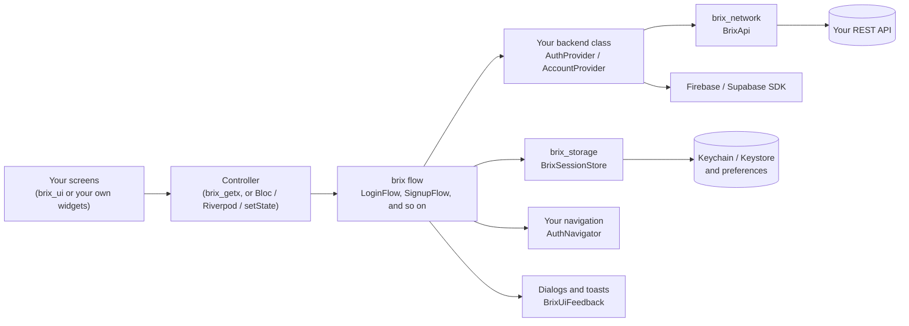

# brix

[](https://github.com/mrubaz/brix/actions/workflows/ci.yml)
[](https://pub.dev/packages/brix)
[](https://pub.dev/packages/brix_getx)
[](https://pub.dev/packages/brix_network)
[](https://pub.dev/packages/brix_storage)
[](https://pub.dev/packages/brix_ui)
[](LICENSE)

Most Flutter apps start with the same work: a login screen, signup with an email code, a forgot password flow, a profile page, API calls, saving the session and showing errors. brix does that part for you, so you can spend your time on the screens that make your app different.


It works with any backend. REST APIs (Node, Laravel, Django, FastAPI and so on), Firebase and Supabase all fit; you write one small class that talks to yours.

It works with any state library. The logic is plain Dart. Ready GetX controllers come in brix_getx, and Riverpod, Bloc, Provider or `setState` need only a few lines.

Your app keeps its own look. brix_ui gives you buttons, fields, dialogs and toasts that take your colours, font and shape, in light and dark. You can also skip it and use your own widgets.

Updates are safe. New features come with defaults, so a new version does not ask you to change your code.

## The packages

Take only what you need. Each one is its own package.

| Package | What it does |
|---|---|
| [brix](packages/brix) | The logic: login, signup, email code, forgot and reset password, app start, logout, profile, change password, delete account. Also `Result`, `Failure`, `Json` and `BrixLogger`. Pure Dart. |
| [brix_getx](packages/brix_getx) | A GetX controller for every brix screen, with the text fields, form key and loading state ready. |
| [brix_network](packages/brix_network) | REST calls on Dio that return a `Result`, with readers for common API shapes, field errors, uploads and downloads. |
| [brix_storage](packages/brix_storage) | Values and secrets (Keychain and Keystore) that survive reinstalls, plus a ready session store. |
| [brix_ui](packages/brix_ui) | Buttons, text fields, a select, dialogs, sheets, toasts and a loader from one theme, light and dark. |
| [brix_cli](packages/brix_cli) | `brix create my_app` makes a new app with all of the above already wired. Not on pub.dev yet. |

```
flutter pub add brix_getx brix_network brix_storage brix_ui
```

Using another state library, Firebase or Supabase? Start with `flutter pub add brix`.

## How it fits together



You write a few small classes once: one for your backend and one for navigation. Storage and dialogs come ready from brix_storage and brix_ui. Every flow then uses them.

## A login with GetX and a REST API

```dart
// 1. The API, once.
final api = BrixApi(
  baseUrl: 'https://api.example.com/v1/',
  token: () => storage.readToken(),
  onUnauthorized: () => session.logout(),
);

// 2. Your backend adapter.
class MyAuth extends AuthProvider<SignupBody, User> {
  @override
  AuthCapabilities get capabilities => const AuthCapabilities(otpAfterSignup: true);

  @override
  Future<Result<AuthSession<User>>> login({
    required String identifier,
    required String password,
  }) => api.post(
    'auth/login',
    body: {'email': identifier, 'password': password},
    parse: (data) => AuthSession(
      accessToken: data.string('token'),
      user: User.fromJson(data.child('user')),
    ),
  );

  @override
  Future<Result<void>> logout() => api.post('auth/logout');
}

// 3. Where the session lives (tokens in Keychain / Keystore).
final store = BrixSessionStore<User>(
  storage: BrixStorage(),
  userToJson: (user) => user.toJson(),
  userFromJson: User.fromJson,
);

// 4. The screen's controller, with dialogs and toasts from brix_ui.
Get.put(BrixLoginController<User>(LoginFlow(
  provider: MyAuth(),
  store: store,
  navigator: MyNavigator(),
  feedback: const BrixUiFeedback(),
)));
```

And the screen:

```dart
// 5. The screen.
BrixTextField(controller: c.identifierController, label: 'Email', isRequired: true),
BrixTextField(controller: c.passwordController, label: 'Password', isPassword: true),
Obx(() => BrixButton(label: 'Log in', isLoading: c.isSubmitting.value, onPressed: c.login)),
```

That is the whole login. Remember me, ignoring double taps, saving the session, showing errors and opening the home screen are already handled.

## Your look, light and dark

brix_ui reads everything from one `BrixTheme`, so the same widgets look like your app, and dark mode needs no change to your screens.

```dart
MaterialApp(
  theme: BrixTheme.light(colors: const BrixColors.light(primary: brand)).toThemeData(),
  darkTheme: BrixTheme.dark(colors: const BrixColors.dark(primary: brand)).toThemeData(),
);
```


There is much more in the [brix_ui README](packages/brix_ui): buttons, fields, dialogs, toasts and how to swap in your own widgets.

## A console you can read

`BrixLogger` prints your own messages and `PrettyNetworkLogger` prints every API call, each in its own box with a colour per level. Both stay quiet in release builds, and passwords and tokens are always hidden.


## Examples

| Example | What you see |
|---|---|
| [brix_cli app template](packages/brix_cli/templates/app) | The app `brix create` makes: every screen, a local test backend and tests |
| [GetX demo](packages/brix_getx/example) | Login, signup with a code, password reset and logout on a demo backend, no server needed |
| [brix in plain Dart](packages/brix/example/main.dart) | A login without Flutter |
| [brix_network](packages/brix_network/example/main.dart) | Loading a list from a public API |
| [brix_storage](packages/brix_storage/example/main.dart) | Saving a value and a secret |
| [brix_ui example](packages/brix_ui/example) | Every widget on one screen, with light, dark and three brands |

## Quality

Every flow, controller, network piece and widget has tests. On every push, CI checks formatting, analysis and the tests of every package and example. It also creates a fresh app with `brix create`, runs its tests and checks that its release build holds no test accounts.

The screenshots are made from the real widgets, not drawn by hand.

MIT licensed.

## Working on brix

```
git clone https://github.com/mrubaz/brix.git
cd brix/packages/brix && dart pub get && dart test
```

Each package has its own `dart test` or `flutter test`. A `pubspec_overrides.yaml` in each package points it at the others in this repo, so they are built together.

Questions and ideas are welcome in the [issues](https://github.com/mrubaz/brix/issues).
