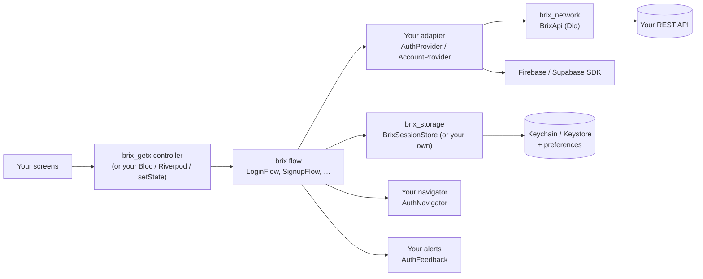

# brix

[](https://github.com/mrubaz/brix/actions/workflows/ci.yml)
[](https://pub.dev/packages/brix)
[](https://pub.dev/packages/brix_getx)
[](https://pub.dev/packages/brix_network)
[](https://pub.dev/packages/brix_storage)
[](LICENSE)

**The building blocks every Flutter app needs – ready, tested, and yours to style.**

Every app writes the same things again: login, signup, email codes, password reset, profile, logout, API calls, error messages. brix gives you that logic once, done right, so you only build the screens.

- 🔌 **Any backend** – REST (Node, FastAPI, Django, Laravel, …), Firebase, Supabase. You write one small adapter.
- 🧩 **Any state management** – the logic is pure Dart. GetX controllers are ready; Riverpod, Bloc, Provider and `setState` work with a few lines.
- 🎨 **Your UI** – brix has no screens. It tells your screens what to show and where to go.
- 🛡️ **Safe by default** – passwords never trimmed or logged, double taps ignored, secrets hidden in logs, one logout for many 401s.
- 🔄 **Updates don't break your app** – new features arrive with defaults; new values work with a default `switch` case.

## Packages

| Package | What it gives you | Use it when |
|---|---|---|
| [**brix**](packages/brix) | Login, signup, email code, forgot / reset password, app start + logout, profile, change password, delete account. `Result`, `Failure`, `Json`, `BrixLogger`. | Always – it is the core. Pure Dart. |
| [**brix_getx**](packages/brix_getx) | A GetX controller for every brix screen: text fields, form key, loading state, code boxes, password checklist. One import includes brix. | Your app uses GetX. |
| [**brix_network**](packages/brix_network) | REST calls on Dio that return a `Result`; readers for common API shapes, field errors, uploads, a readable log. | Your backend is a REST API. |
| [**brix_storage**](packages/brix_storage) | Values and secrets (Keychain / Keystore) that survive reinstalls and broken keystores safely; a ready session store for brix. | Always useful – saves writing your own session store. |

```
flutter pub add brix_getx brix_network brix_storage   # GetX app with a REST backend
flutter pub add brix                     # any other state library / Firebase / Supabase
```

Your app gets only the packages you add. Examples and the other packages are never built into it.

## Everything included

| Area | What you get |
|---|---|
| Auth | login with remember me, signup, email code (boxes, paste / autofill, resend countdown), forgot / reset password, password rules with a live checklist |
| Account | app start (splash), logout, profile + avatar, change password, delete account with a code |
| Errors | `Result` instead of exceptions; backend messages, else plain default texts; form errors per field (`failure.fieldError('email')`) |
| Network | Dio by default (any client), uploads with progress, file / PDF downloads, cancel, retries only where safe, one logout for many 401s, readers for envelope / FastAPI / Django REST APIs |
| Storage | values + secrets, reinstall-safe Keychain, broken Keystore never crashes, ready session store |
| JSON | `Json` reads any backend's data into models without crashes |
| Logs | readable console for your messages and every API call, secrets hidden, off in release |
| Tests | fakes for every contract (`package:brix/testing.dart`), `MemoryStore`, fake network client examples |
| Updates | switch-safe values and default method bodies – new versions don't break your app |

## How the pieces fit



You write the small classes once (backend, screens, alerts); storage comes ready with `brix_storage`. Every flow uses them. `BrixLogger` (in brix) and the network log give one readable console.

## A login in a few lines (GetX + REST)

```dart
// 1. The API, once.
final api = BrixApi(
  baseUrl: 'https://api.example.com/v1/',
  token: () => storage.readToken(),
  onUnauthorized: () => session.logout(),
);

// 2. Your backend adapter.
class MyAuth extends AuthProvider<SignupBody, User> {
  @override
  AuthCapabilities get capabilities => const AuthCapabilities(otpAfterSignup: true);

  @override
  Future<Result<AuthSession<User>>> login({
    required String identifier,
    required String password,
  }) => api.post(
    'auth/login',
    body: {'email': identifier, 'password': password},
    parse: (data) => AuthSession(
      accessToken: data.string('token'),
      user: User.fromJson(data.child('user')),
    ),
  );

  @override
  Future<Result<void>> logout() => api.post('auth/logout');
}

// 3. Where the session lives (tokens in Keychain / Keystore).
final store = BrixSessionStore<User>(
  storage: BrixStorage(),
  userToJson: (user) => user.toJson(),
  userFromJson: User.fromJson,
);

// 4. The screen's controller.
Get.put(BrixLoginController<User>(LoginFlow(
  provider: MyAuth(),
  store: store,
  navigator: MyNavigator(),
  feedback: MyAlerts(),
)));
```

The screen binds `identifierController`, `passwordController`, `isSubmitting` and calls `login()`. Remember me, the double-tap guard, saving the session, error messages and opening home are done.

## Readable console

`BrixLogger` (brix) for your own messages, `PrettyNetworkLogger` (brix_network) for every API call – both off in release builds, secrets hidden.

```dart
final log = BrixLogger(name: 'MyApp');
log.error('Saving failed', error: error, stackTrace: stackTrace);
```

```
14:32:07.210  ✗ ERROR  MyApp  Saving failed
                ↳ Bad state: boom
                  #0 SaveFlow.run (save_flow.dart:42)
┌─ POST v1/auth/login ──────────────────────────── 200 · 312 ms
│ → {"email": "ada@brix.dev", "password": "••••"}
│ ← {"success": true, "message": "Welcome back!", …}
└────────────────────────────────────────────────────────────────
```

## Examples

| Example | Shows |
|---|---|
| [Flutter demo app](packages/brix_getx/example) | Login, signup with an email code, forgot / reset password, logout – on an in-memory backend, runs without a server (`demo@brix.dev` / `Demo@1234`, code `123456`) |
| [brix in plain Dart](packages/brix/example/main.dart) | A login without Flutter or a state library |
| [brix_network](packages/brix_network/example/main.dart) | Loading a list from a public REST API into models |
| [brix_storage](packages/brix_storage/example/main.dart) | Saving a value and a secret |

## Quality

- Every flow, controller and network piece has unit tests. CI checks format, analysis (no infos) and tests of every package and example on each push.
- Values you switch over are classes, not enums – see [updates never break your app](packages/brix#updates-never-break-your-app).
- MIT licensed.

## Develop

```
git clone https://github.com/mrubaz/brix.git
cd brix/packages/brix && dart pub get && dart test
cd ../brix_network && dart pub get && dart test
cd ../brix_storage && flutter pub get && flutter test
cd ../brix_getx && flutter pub get && flutter test
```

Each package's `pubspec_overrides.yaml` points it at the brix in this repo, so they are developed together.

Issues and ideas: [GitHub issues](https://github.com/mrubaz/brix/issues).
