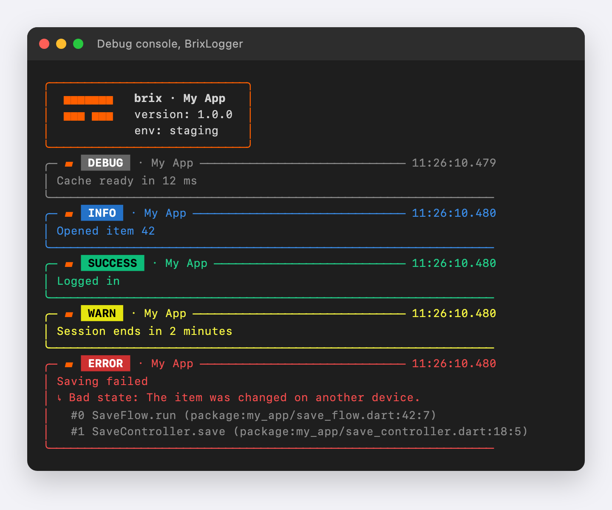

# brix

The logic every Flutter app writes again and again, written once: login, signup, email codes, password reset, profile, change password, delete account, app start and logout.

brix works with any backend. You write one small class for your API, whether that is REST, Firebase or Supabase.

It works with any state library. brix is plain Dart, with no Flutter or state library inside, and a thin wrapper connects it to yours. For GetX that wrapper is ready: [brix_getx](https://pub.dev/packages/brix_getx).

It has no screens of its own. brix tells your screens what to show and where to go. If you want ready widgets, use [brix_ui](https://pub.dev/packages/brix_ui).

The defaults are safe. Passwords are never trimmed or logged, a double tap does not send a request twice, and a failed logout on the server still logs you out on the device.

Updates do not break your app. New calls come with default bodies, and new values work with a default `switch` case.

Here is an app built on brix ([made with brix_cli](https://github.com/mrubaz/brix/tree/main/packages/brix_cli)):


## Install

```
dart pub add brix
```

| Import | What you get |
|---|---|
| `package:brix/auth.dart` | login, signup, email code, forgot / reset password, password rules |
| `package:brix/account.dart` | app start + logout, profile, change password, delete account (includes auth) |
| `package:brix/core.dart` | `Result`, `Failure`, `Json`, `BrixLogger`, `BrixFlow` |
| `package:brix/testing.dart` | fakes for your tests |

## How it works

You write four small classes once. Every flow uses them:

| You write | What it does |
|---|---|
| `AuthProvider` | calls your backend (`login`, `logout` required; signup, codes, reset optional) |
| `AuthSessionStore` | keeps the session between launches (use secure storage for tokens) |
| `AuthNavigator` | opens your screens (`toHome`, `toLogin` required) |
| `AuthFeedback` | shows errors, warnings and success messages your way |

A flow holds a small immutable state (`isSubmitting`, ...) and tells you when it changes (`flow.changes`). Show a loader from it; call the flow's methods from your buttons.

Every backend call returns a `Result`: `Success(data, message: ...)` or `Failed(failure)`. A `Failure` says what kind of problem it was, `ValidationFailure`, `UnauthorizedFailure`, `ServerFailure`, `NetworkFailure`, `UnsupportedFailure`, `UnknownFailure`, and carries the backend's messages.

### What happens on a tap

```
 Your screen               brix flow                  your classes
 ───────────               ─────────                  ────────────
 [Log in] ──submit()────▶  LoginFlow ──login()──────▶ AuthProvider ──▶ backend
                              │  ◀────── Result ───────────┘
                              ├─ Success ─▶ AuthSessionStore.saveSession
                              │             AuthFeedback.success(message)
                              │             AuthNavigator.toHome()
                              └─ Failed ──▶ AuthFeedback.failure(failure)
 loader ◀── changes (isSubmitting) ──┘
```

### The journeys

```
 Signup ──▶ code after signup? ── yes ──▶ Code screen ──verify──▶ Login (email filled) ──▶ Home
                               └─ no ───▶ Login (email filled)

 Forgot ──▶ ResetMode.otp  ──▶ Reset screen (code + new password) ──▶ Login (email filled)
        └─▶ ResetMode.link ──▶ "check your email" ──────────────────▶ Login

 App start ──▶ code still waiting? ──▶ Code screen
           ──▶ saved session ───────▶ refresh user ──▶ Home      (401 ──▶ Login)
           ──▶ nothing saved ───────▶ Login

 Logout ──▶ server logout ──▶ local session cleared (remember me kept) ──▶ Login
```

## 1. The backend: `AuthProvider`

```dart
import 'package:brix/auth.dart';

class MyAuthProvider extends AuthProvider<SignupBody, User> {
  MyAuthProvider(this.api);

  final MyApi api;

  /// What your backend does: code after signup? reset by code or link?
  @override
  AuthCapabilities get capabilities => const AuthCapabilities(
    otpAfterSignup: true,
    resetMode: ResetMode.otp,
    otpLength: 6,
  );

  @override
  Future<Result<AuthSession<User>>> login({
    required String identifier,
    required String password,
  }) async {
    final response = await api.post('auth/login', {
      'email': identifier,
      'password': password, // brix never changes a password – send it as is
    });
    if (response.statusCode == 401) {
      return Failed(ValidationFailure(messages: [response.message]));
    }
    return Success(
      AuthSession(accessToken: response.token, user: User.fromJson(response.data)),
      message: response.message,
    );
  }

  @override
  Future<Result<void>> logout() async {
    await api.post('auth/logout', {});
    return const Success(null);
  }

  // Optional – override only what your backend has:
  // register, verifyOtp, resendOtp, forgotPassword, resetPassword.

  /// Errors your API client throws (no connection, timeouts).
  @override
  Failure mapError(Object error, StackTrace stackTrace) => switch (error) {
    SocketException() => NetworkFailure(),
    _ => super.mapError(error, stackTrace),
  };
}
```

## 2. Storage, screens and alerts

```dart
// Ready-made: `BrixSessionStore` from brix_storage (Keychain / Keystore,
// reinstall-safe). Or write your own:
class MySessionStore extends AuthSessionStore<User> {
  @override
  Future<void> saveSession(AuthSession<User> session) async {
    // Write the token to secure storage, the user wherever you like.
  }

  @override
  Future<AuthSession<User>?> readSession() async {
    // Read it back; null when nobody is logged in.
  }

  @override
  Future<void> clearSession() async {
    // Delete the token and the user.
  }

  // Optional: savePendingIdentifier (code screen after a restart) and
  // saveRememberedCredentials ("remember me").
}

class MyNavigator extends AuthNavigator {
  @override
  Future<void> toHome() async => router.go('/home');

  @override
  Future<void> toLogin({String? identifier}) async =>
      router.go('/login', extra: identifier); // fill the email when given

  // Optional, when your capabilities need them:
  // toSignup, toOtp, toForgotPassword, toResetPassword, back.
}

class MyFeedback extends AuthFeedback {
  @override
  void failure(Failure failure) => showError(failure.displayMessage);

  @override
  void warning(AuthWarning warning) => showWarning(warning.message);

  @override
  void success(String? message) {
    if (message != null) showSnackbar(message);
  }
}
```

Do not wait for a new screen to close inside a navigator method (e.g. do not return `Navigator.push`'s future); the flow would stay busy.

## 3. Login

```dart
final login = LoginFlow<User>(
  provider: MyAuthProvider(api),
  store: MySessionStore(),
  navigator: MyNavigator(),
  feedback: MyFeedback(),
  onLoggedIn: (session) => currentUser = session.user, // optional
);

// Fill the form from "remember me".
final saved = await login.loadRemembered(); // email + password, or null

// Button: double taps are ignored; email trimmed, password sent as typed.
await login.submit(identifier: email, password: password, rememberMe: true);

// Loader.
login.changes.listen((state) => setLoading(state.isSubmitting));

// Screen closed.
login.dispose();
```

Success: the session is saved, "remember me" saved or cleared, the backend's message shown, home opened. Failure: the error is shown, nothing saved.

## 4. Signup and the email code

```dart
final signup = SignupFlow<SignupBody, User>(
  provider: provider,
  store: store,
  navigator: navigator,
  feedback: feedback,
  passwordPolicy: const PasswordPolicy(), // 8+, capital, small, number, special
);

// Your own checks (terms accepted, …) run before this.
await signup.submit(
  request: SignupBody(name: name, email: email, password: password),
  identifier: email,
  password: password,
);
// otpAfterSignup → email kept as "pending", code screen opened.
// otherwise      → login opened with the email filled.
```

Code screen:

```dart
final otp = OtpVerificationFlow<User>(
  provider: provider,
  store: store,
  navigator: navigator,
  feedback: feedback,
  resendCooldown: const Duration(seconds: 30),
);

await otp.start(); // reads the pending email (also after an app restart)

otp.state.maskedIdentifier; // "ad•••@mail.com"
otp.state.resendIn;         // time left before "resend" works
otp.state.failedAttempts;   // went up → clear your code boxes

await otp.verify('123456'); // right → login with the email filled
await otp.resend();
await otp.changeIdentifier(); // wrong email → back to signup
```

## 5. Forgot and reset password

```dart
final forgot = ForgotPasswordFlow(
  provider: provider,
  navigator: navigator,
  feedback: feedback,
);
await forgot.submit(identifier: email);
// ResetMode.otp  → reset screen opened (code + new password)
// ResetMode.link → message shown, login opened

final reset = ResetPasswordFlow(
  provider: provider,
  navigator: navigator,
  feedback: feedback,
  identifier: email,
  store: store, // optional: updates a remembered password
);
await reset.start();
await reset.submit(code: '123456', newPassword: 'New@Pass1');
// → login with the email filled
```

## 6. App start and logout

```dart
final session = SessionFlow<User>(
  auth: provider,
  store: store,
  navigator: navigator,
  feedback: feedback,
  account: accountProvider, // optional: refresh the user on start
);

await session.start();
// waiting signup code → code screen; saved session → home;
// rejected session (401) → login; nothing saved → login.

await session.logout(); // server logout, then always local logout
```

## 7. Account: profile, change password, delete

Write an `AccountProvider` with only the calls you have:

```dart
class MyAccountProvider extends AccountProvider<User, ProfileBody> {
  @override
  AccountDeletionMode get deletionMode => AccountDeletionMode.code;

  @override
  Future<Result<User>> currentUser() async { /* GET profile */ }

  @override
  Future<Result<void>> updateProfile(ProfileBody update) async { /* PATCH */ }

  @override
  Future<Result<void>> uploadAvatar(AvatarUpload avatar) async {
    // avatar.path on mobile, avatar.bytes on web
  }

  @override
  Future<Result<void>> changePassword({
    required String currentPassword,
    required String newPassword,
  }) async { /* … */ }

  @override
  Future<Result<void>> requestAccountDeletion({required String identifier}) async {
    // email a code
  }

  @override
  Future<Result<void>> deleteAccount({
    required String identifier,
    String? code,
    String? password,
  }) async { /* … */ }
}
```

```dart
// Profile
final profile = ProfileFlow<User, ProfileBody>(account: account, feedback: feedback);
await profile.load();                         // state.user, state.isLoading
await profile.save(ProfileBody(name: 'Ada')); // saved, then reloaded
await profile.uploadAvatar(AvatarUpload(fileName: 'me.jpg', path: file.path));

// Change password (stays logged in)
final change = ChangePasswordFlow(
  account: account,
  store: store,
  navigator: navigator,
  feedback: feedback,
);
await change.submit(currentPassword: old, newPassword: newer);

// Delete account with an emailed code
final delete = DeleteAccountFlow(
  account: account,
  store: store,
  navigator: navigator,
  feedback: feedback,
  identifier: user.email,
);
await delete.requestDeletion(); // code sent
await delete.confirm('123456'); // deleted, everything cleared, login opened
```

## Reading JSON safely

`Json` reads decoded JSON from any backend (REST, Firebase, Supabase, ...) into your models without crashes:

```dart
factory User.fromJson(Json json) => User(
  id: json.string('id'),
  name: json.string('profile.firstName'),   // paths for nested values
  age: json.integer('age'),                 // 31, 31.0 and "31" all work
  isActive: json.boolean('active'),         // true, "true", 1
  createdAt: json.dateOrNull('createdAt'),  // ISO text or epoch milliseconds
  roles: json.list('roles', Role.fromJson),
);

final user = User.fromJson(Json(jsonDecode(body)));
```

A missing key or a wrong type gives the fallback (`''`, `0`, `false`, empty list) or `null` for the `...OrNull` readers, never an exception. See them while developing:

```dart
Json.onProblem = (path, problem) => debugPrint('JSON $path: $problem');
// JSON roles[0].level: expected a whole number, got String "high"
```

## Logging



```dart
final log = BrixLogger(name: 'My App');

log.banner('My App', details: {'version': '1.2.0', 'env': 'staging'});
log.info('Opened item 42');
log.success('Logged in');
log.warning('Cache is old');
log.error('Saving failed', error: error, stackTrace: stackTrace);
```

```
╭──────────────────────────────╮
│  ▆▆▆▆▆▆▆   brix · My App     │
│  ▆▆▆ ▆▆▆   version: 1.2.0    │
│            env: staging      │
╰──────────────────────────────╯
╭─ ▰ SUCCESS · My App ─────────────────────────── 14:32:05.123
│ Logged in
╰───────────────────────────────────────────────────────────────
╭─ ▰ ERROR · My App ───────────────────────────── 14:32:07.210
│ Saving failed
│ ↳ Bad state: boom
│   #0 SaveFlow.run (save_flow.dart:42)
╰───────────────────────────────────────────────────────────────
```

One box per message, so three info lines in a row still read as three. Colours: debug grey, info blue, success green (`success()` logs at info level), warning yellow, error red; the level sits in a coloured badge and `▰` is the brix mark. Nothing is printed in release builds. `minLevel: LogLevel.warning` hides the chatter, `colors: false` suits the Xcode console, `stackLines` cuts long traces, output goes to the IDE console (colours on iOS too); `output: print` for a terminal, or any function to send lines elsewhere.

## With your state library

Every flow has `state` (now) and `changes` (a stream of new states). Connect it to whatever your app uses, and `dispose()` it when the screen closes.

**GetX**: ready-made controllers in [brix_getx](https://pub.dev/packages/brix_getx).

**Riverpod**

```dart
final loginFlowProvider = Provider.autoDispose<LoginFlow<User>>((ref) {
  final flow = LoginFlow<User>(provider: api, store: store, navigator: nav, feedback: alerts);
  ref.onDispose(flow.dispose);
  return flow;
});

final loginStateProvider = StreamProvider.autoDispose<AuthFormState>(
  (ref) => ref.watch(loginFlowProvider).changes,
);

// Widget
final busy = ref.watch(loginStateProvider).value?.isSubmitting ?? false;
onPressed: busy ? null : () => ref.read(loginFlowProvider).submit(identifier: email, password: password),
```

**Bloc**

```dart
class LoginCubit extends Cubit<AuthFormState> {
  LoginCubit(this.flow) : super(flow.state) {
    _subscription = flow.changes.listen(emit);
  }

  final LoginFlow<User> flow;
  late final StreamSubscription<AuthFormState> _subscription;

  Future<void> login(String email, String password) =>
      flow.submit(identifier: email, password: password);

  @override
  Future<void> close() async {
    await _subscription.cancel();
    await flow.dispose();
    return super.close();
  }
}
```

**Provider**

```dart
class LoginNotifier extends ChangeNotifier {
  LoginNotifier(this.flow) {
    _subscription = flow.changes.listen((_) => notifyListeners());
  }

  final LoginFlow<User> flow;
  late final StreamSubscription<AuthFormState> _subscription;

  bool get isSubmitting => flow.state.isSubmitting;

  Future<void> login(String email, String password) =>
      flow.submit(identifier: email, password: password);

  @override
  void dispose() {
    _subscription.cancel();
    flow.dispose();
    super.dispose();
  }
}
```

**setState**

```dart
class _LoginScreenState extends State<LoginScreen> {
  late final flow = LoginFlow<User>(provider: api, store: store, navigator: nav, feedback: alerts);

  @override
  Widget build(BuildContext context) {
    return StreamBuilder<AuthFormState>(
      stream: flow.changes,
      initialData: flow.state,
      builder: (context, snapshot) => FilledButton(
        onPressed: snapshot.data!.isSubmitting
            ? null
            : () => flow.submit(identifier: email, password: password),
        child: const Text('Log in'),
      ),
    );
  }

  @override
  void dispose() {
    flow.dispose();
    super.dispose();
  }
}
```

The same works for every flow (signup, code, reset, profile, ...), only the state type changes.

## Texts

Backend messages always come first. When the backend sends none, brix has a plain English text, so you need no own text for the basics, and you can always show your own:

```dart
@override
void failure(Failure failure) => showError(switch (failure) {
  NetworkFailure() => 'You are offline.', // your wording, if you want
  _ => failure.displayMessage,             // backend message, else brix's text
});

@override
void warning(AuthWarning warning) => showWarning(switch (warning) {
  AuthWarning.otpIncomplete => 'Please enter all 6 digits.',
  _ => warning.message, // also for warnings added in later versions
});
```

Password checklist: `for (final rule in policy.rules) Text(rule.labelFor(policy))` shows "At least 8 characters", "One capital letter (A-Z)", ... and `policy.unmetRules(password)` for the ticks.

Form errors per field arrive in `failure.fieldErrors`, show them under the field:

```dart
TextFormField(decoration: InputDecoration(errorText: failure?.fieldError('email')))
```

Your own checks and errors use the same types: `const AuthWarning('termsNotAccepted', 'Accept the terms first.')`, or a `Failure` subclass that overrides `defaultMessage`.

## Updates never break your app

- `AuthWarning`, `PasswordRule` and `OtpPurpose` are classes, not enums: always `switch` with a default case (`_ =>`), and values added later just work.
- New provider, store and navigator methods arrive with a default body, so your classes keep compiling.

## Testing

```dart
import 'package:brix/testing.dart';

final provider = FakeAuthProvider<void, String>()
  ..loginResult = Failed(ValidationFailure(messages: ['Wrong password']));
final navigator = RecordingAuthNavigator();
final feedback = RecordingAuthFeedback();

final flow = LoginFlow<String>(
  provider: provider,
  store: InMemoryAuthSessionStore(),
  navigator: navigator,
  feedback: feedback,
);
await flow.submit(identifier: 'a@b.com', password: 'x');

expect(feedback.failures.single.messages, ['Wrong password']);
expect(navigator.visits, isEmpty);
```

## Example

[example/main.dart](https://github.com/mrubaz/brix/blob/main/packages/brix/example/main.dart): a login in plain Dart (`dart run example/main.dart`). A full Flutter app: [brix_getx example](https://github.com/mrubaz/brix/tree/main/packages/brix_getx/example).

## License

MIT
