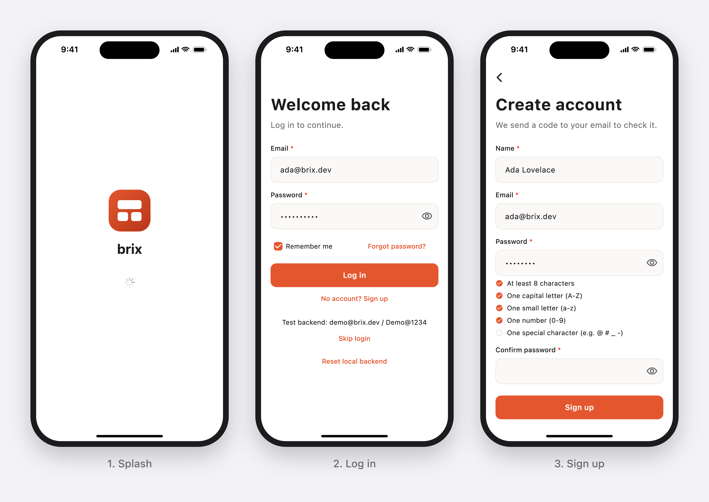
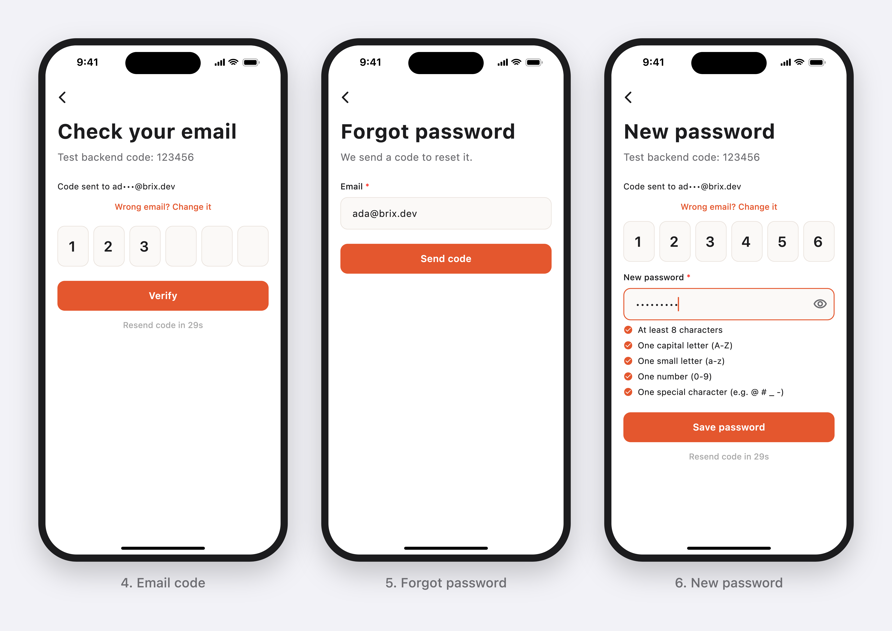

Bloc Cubits for every account screen of a Flutter app: login, signup, email code (OTP), forgot and reset password, profile, change password, delete account, splash and logout. Each holds an immutable state and the methods a screen calls; the logic comes from [brix](https://pub.dev/packages/brix).

[](https://pub.dev/packages/brix_bloc)
[](https://github.com/mrubaz/brix/actions/workflows/ci.yml)
[](https://github.com/mrubaz/brix/blob/main/LICENSE)





Starting a new app? `brix create my_app` from [brix_cli](https://pub.dev/packages/brix_cli) makes these screens on Bloc for you.

## Features

- One `Cubit` per screen; the brix flow comes through the constructor and is disposed when the cubit closes.
- No Flutter objects inside, as the Bloc docs recommend: your screen owns its text fields, form key and code boxes and sends what is typed.
- Immutable states with `copyWith` and Equatable, so equal states are never emitted twice.
- Remember me, email pre-fill after signup or reset, show / hide password.
- Live password rules for signup, reset and change password.
- Code screens with resend countdown, a failed attempt counter and `OtpCodeBoxes` (paste, autofill, auto submit).
- Works with any backend: you write the adapters once in brix.

| Cubit | State | Screen |
|---|---|---|
| `BrixLoginCubit` | `BrixLoginState` | login, remember me, email pre-fill |
| `BrixSignupCubit` | `BrixSignupState` | signup (you add your own values and build the request) |
| `BrixOtpCubit` | `CodeEntryState` | code after signup |
| `BrixForgotPasswordCubit` | `BrixForgotPasswordState` | forgot password |
| `BrixResetPasswordCubit` | `BrixResetPasswordState` | code and new password |
| `BrixChangePasswordCubit` | `BrixChangePasswordState` | change password |
| `BrixProfileCubit` | `ProfileState` | profile load, save and avatar |
| `BrixDeleteAccountCubit` | `CodeEntryState` | delete account with a code |
| `BrixSessionCubit` | `SessionState` | splash (`start`) and logout |

## Install

```bash
flutter pub add brix_bloc flutter_bloc
```

One import gives you brix too:

```dart
import 'package:brix_bloc/brix_bloc.dart';
```

The logic lives in [brix](https://pub.dev/packages/brix); read its README for the four classes you write once (backend, session store, navigator, alerts).

## Usage

### Give each screen its cubit

`BlocProvider` creates the cubit with its flow and closes it with the screen:

```dart
BlocProvider(
  create: (_) => BrixLoginCubit<User>(
    LoginFlow(
      provider: myBackend,
      store: mySessionStore,
      navigator: myNavigator,
      feedback: myFeedback,
    ),
  ),
  child: const LoginScreen(),
)
```

### A screen

The screen owns its fields, sends what is typed, checks its form, then calls the cubit:

```dart
class _LoginScreenState extends State<LoginScreen> {
  final _formKey = GlobalKey<FormState>();
  final _email = TextEditingController();
  final _password = TextEditingController();

  BrixLoginCubit<User> get _cubit => context.read<BrixLoginCubit<User>>();

  @override
  void dispose() {
    _email.dispose();
    _password.dispose();
    super.dispose();
  }

  @override
  Widget build(BuildContext context) {
    return BlocConsumer<BrixLoginCubit<User>, BrixLoginState>(
      // Remembered details and a pre-filled email arrive in the state.
      listener: (context, state) {
        if (_email.text != state.identifier) _email.text = state.identifier;
        if (_password.text != state.password) _password.text = state.password;
      },
      builder: (context, state) => Form(
        key: _formKey,
        child: Column(
          children: [
            TextFormField(controller: _email, onChanged: _cubit.identifierChanged),
            TextFormField(
              controller: _password,
              onChanged: _cubit.passwordChanged,
              obscureText: state.obscurePassword,
            ),
            FilledButton(
              onPressed: state.isSubmitting
                  ? null
                  : () {
                      if (_formKey.currentState!.validate()) _cubit.login();
                    },
              child: const Text('Log in'),
            ),
          ],
        ),
      ),
    );
  }
}
```

`prefillIdentifier(email)` fills the email after a signup or a reset; the password is filled only for the remembered account.

### Your own values

Extend the signup cubit, keep extra values and build your request:

```dart
class SignupViewModel extends BrixSignupCubit<SignupRequest, User> {
  SignupViewModel(super.flow);

  String _name = '';

  void nameChanged(String value) => _name = value;

  @override
  SignupRequest buildRequest({
    required String identifier,
    required String password,
  }) => SignupRequest(name: _name.trim(), email: identifier, password: password);
}
```

Override `beforeSubmit` for your own checks, such as accepted terms.

### Code screens

The screen owns an `OtpCodeBoxes` (one field and focus node per digit) and passes the code on:

```dart
late final _cubit = context.read<BrixOtpCubit<User>>();
late final _boxes = OtpCodeBoxes(
  length: _cubit.otpLength,
  onCompleted: () => _cubit.verify(_boxes.code),
);

// A rejected code clears the boxes.
BlocListener<BrixOtpCubit<User>, CodeEntryState>(
  listenWhen: (before, now) => now.failedAttempts != before.failedAttempts,
  listener: (context, state) => _boxes.clear(),
  child: CodeBoxes(boxes: _boxes),
)
```

- OTP and reset start their flow when the cubit is made. Reset opened without an email goes back to login.
- Reset takes the code with the new password: `submit(_boxes.code)`.
- Delete account never deletes on its own: `requestDeletion()` sends the code, `confirm(code)` deletes.

### Password checklist

Signup, reset and change password keep the rules the typed password does not meet yet:

```dart
for (final rule in cubit.passwordRules)
  Text(
    rule.labelFor(cubit.flow.passwordPolicy),
    style: state.unmetPasswordRules.contains(rule) ? muted : done,
  ),
```

### Profile, splash and logout

- `BrixProfileCubit` starts as loading and loads at once. Fill your fields the first time `state.user` arrives, then call `save(yourUpdate)`. `uploadAvatar` keeps unsaved typing.
- Splash: `context.read<BrixSessionCubit<User>>().start()` after the first frame.
- Logout: `logout()` on the same cubit, with `state.isLoggingOut` for the loader.

## Example app

[`example/`](https://github.com/mrubaz/brix/tree/main/packages/brix_bloc/example) is the app `brix create --state bloc` makes: 14 screens on a test backend on the device, no server needed. Log in with `demo@brix.dev` / `Demo@1234`; every code is `123456`.

```bash
cd example && flutter run
```

## Not included yet

- Social login (Google, Apple, Facebook) and phone login.
- Event based `Bloc` classes: the screens use Cubits, the lighter choice the Bloc docs suggest to start with.

## The brix family

| Package | What it does |
|---|---|
| [brix_cli](https://pub.dev/packages/brix_cli) | Start here: `brix create` makes the whole app on Bloc, Riverpod or GetX |
| [brix_ui](https://pub.dev/packages/brix_ui) | Widgets and theme, light and dark |
| [brix_bloc](https://pub.dev/packages/brix_bloc) | Cubits for every account screen |
| [brix_riverpod](https://pub.dev/packages/brix_riverpod) | Riverpod notifiers for every account screen |
| [brix_getx](https://pub.dev/packages/brix_getx) | GetX controllers for every account screen |
| [brix_network](https://pub.dev/packages/brix_network) | API calls that return a result, never throw |
| [brix_storage](https://pub.dev/packages/brix_storage) | Tokens, settings and offline copies, kept safe |
| [brix](https://pub.dev/packages/brix) | The core: login, signup and account flows in pure Dart |

## Help

Questions, bugs and ideas: [GitHub issues](https://github.com/mrubaz/brix/issues).

## License

MIT
