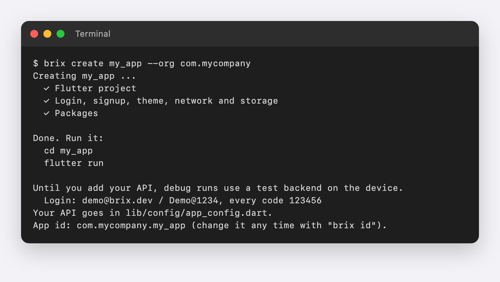
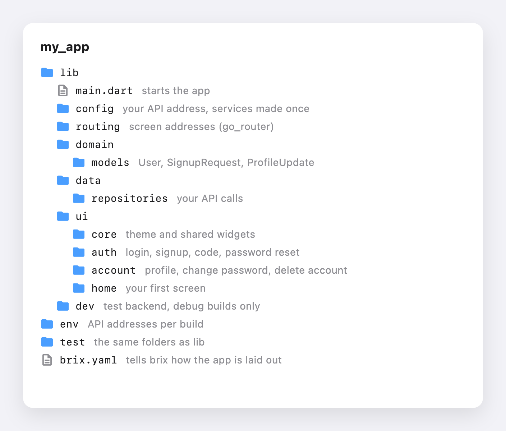

# brix_cli

[](https://pub.dev/packages/brix)
[](https://pub.dev/packages/brix_getx)
[](https://pub.dev/packages/brix_network)
[](https://pub.dev/packages/brix_storage)
[](https://pub.dev/packages/brix_ui)
[](https://pub.dev/packages/brix_cli)
[](https://github.com/mrubaz/brix/blob/main/LICENSE)

Make a new Flutter app that already works: login, signup with an email code, forgot and reset password, profile, change password, delete account and logout. It comes with a theme, API calls, safe storage and tests, all built on [brix](https://github.com/mrubaz/brix).


## Get started

1. Install the command once:

   ```
   dart pub global activate brix_cli
   ```

2. Make an app. Use lowercase letters, digits and underscores for the name, and your company's reverse domain for `--org`:

   ```
   brix create my_app --org com.mycompany
   ```

   

3. Run it:

   ```
   cd my_app
   flutter run
   ```

   Or press F5 in VS Code. Until you add your API, debug runs use a test backend on the device: log in with `demo@brix.dev` and `Demo@1234`, every code is `123456`, or tap "Skip login".

4. Add your API address in `lib/config/app_config.dart`, then match the endpoints in `lib/data/repositories/`. Separate staging and production addresses go in `env/staging.json` and `env/production.json`.

## What is inside

The folders follow the [Flutter architecture guide](https://docs.flutter.dev/app-architecture/case-study): routing on go_router, views and view models for each feature, repositories for your API.



Each screen is a short layout. The logic behind it (forms, loading, double taps, the session, error messages) comes from the brix packages, so it gets better when you run `flutter pub upgrade`, and none of it is copied into your app.

## The test backend

Debug builds without an API run on a small backend that lives on the device, in `lib/dev`. It saves its accounts, so the app behaves as it would with a real server: sign up, verify, log in, change your name or password, delete the account.

Every device keeps its own copy. If two people test with the demo account and one changes the password or deletes the account, the other device is not affected. "Reset local backend" starts that device over, and "Skip login" jumps to the home screen.

When you bring your own login, delete `lib/dev` and the two lines marked `local test backend` in `lib/main.dart`. Nothing else uses them.

## Safe for release

The test backend can never end up in your store app:

- It runs only behind `kDebugMode`, so the compiler leaves it out of release builds, together with its accounts, codes and buttons.
- A release build without an API shows a short setup message instead of a login screen, and only accepts an `https` address.
- On every change, our CI makes a new app, builds it for release on Android and the web and checks that no test account or test button is inside.

## Changing the app id

Picked `com.example` at the start? Change the id on Android, iOS, macOS and Linux with one command, run inside the app:

```
brix id com.mycompany.my_app
```

## Commands

```
brix create <app_name> [--org com.mycompany]   Make a new app
brix id <com.mycompany.app>                    Change the app id everywhere
brix --version
brix --help
```

MIT licensed.

## The brix packages

brix_cli is one part of [brix](https://github.com/mrubaz/brix). Take only the packages you need.

| Package | Version | What it does |
|---|---|---|
| [brix](https://pub.dev/packages/brix) | [](https://pub.dev/packages/brix) | The logic: auth, account, `Result`, `Json`, `BrixLogger` |
| [brix_getx](https://pub.dev/packages/brix_getx) | [](https://pub.dev/packages/brix_getx) | GetX controllers for every brix screen |
| [brix_network](https://pub.dev/packages/brix_network) | [](https://pub.dev/packages/brix_network) | REST calls that return a `Result` |
| [brix_storage](https://pub.dev/packages/brix_storage) | [](https://pub.dev/packages/brix_storage) | Values, secrets and a session store |
| [brix_ui](https://pub.dev/packages/brix_ui) | [](https://pub.dev/packages/brix_ui) | Buttons, fields, select, dialogs, sheets, toasts |
| [brix_cli](https://pub.dev/packages/brix_cli) | [](https://pub.dev/packages/brix_cli) | `brix create my_app`: a new app on all of them |
