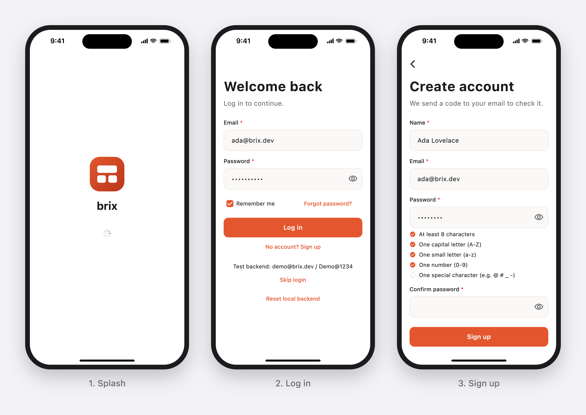
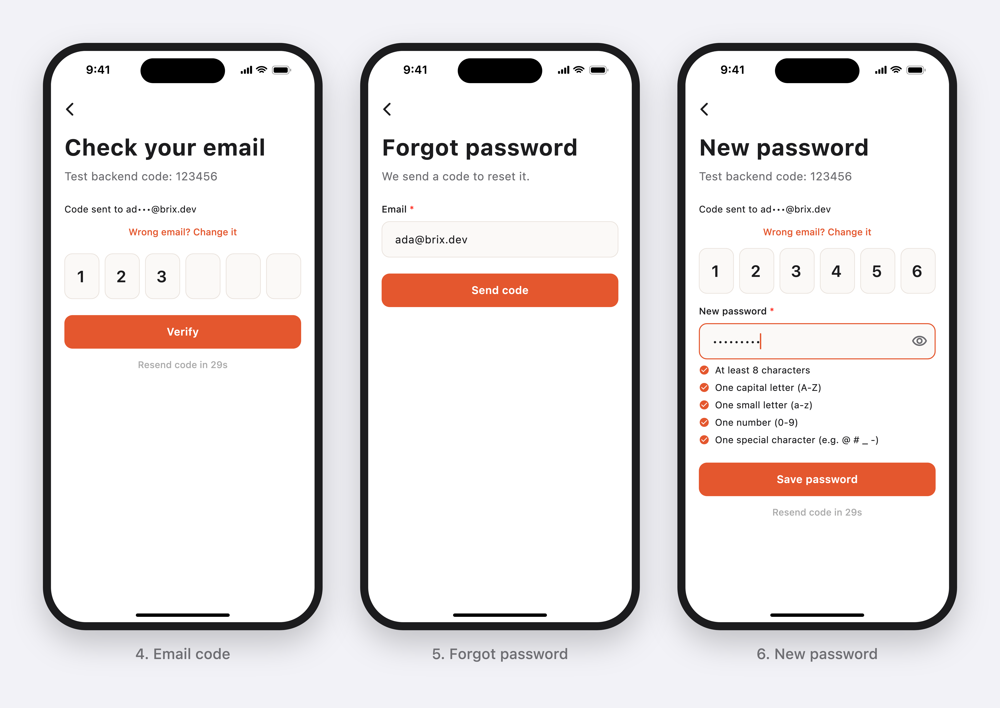
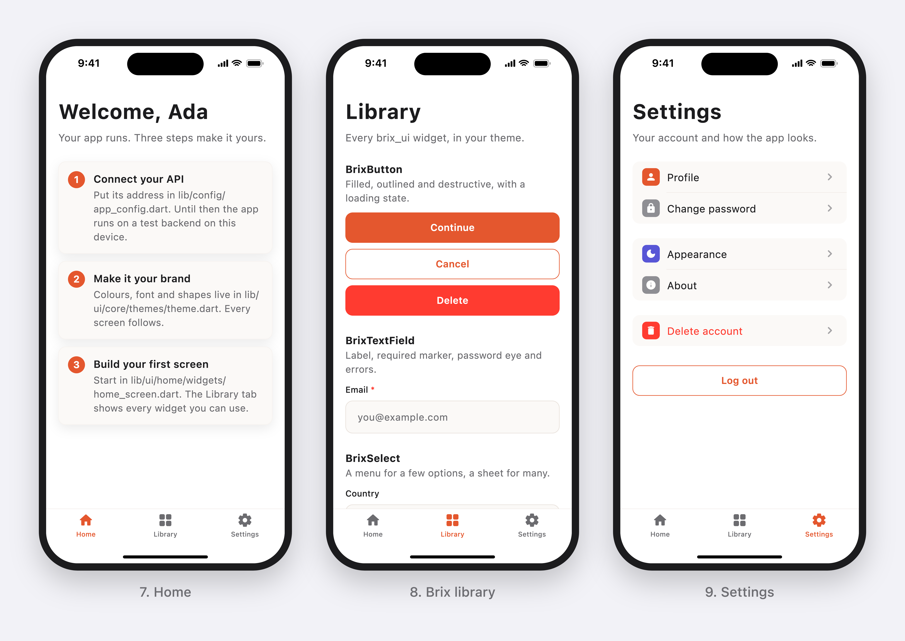
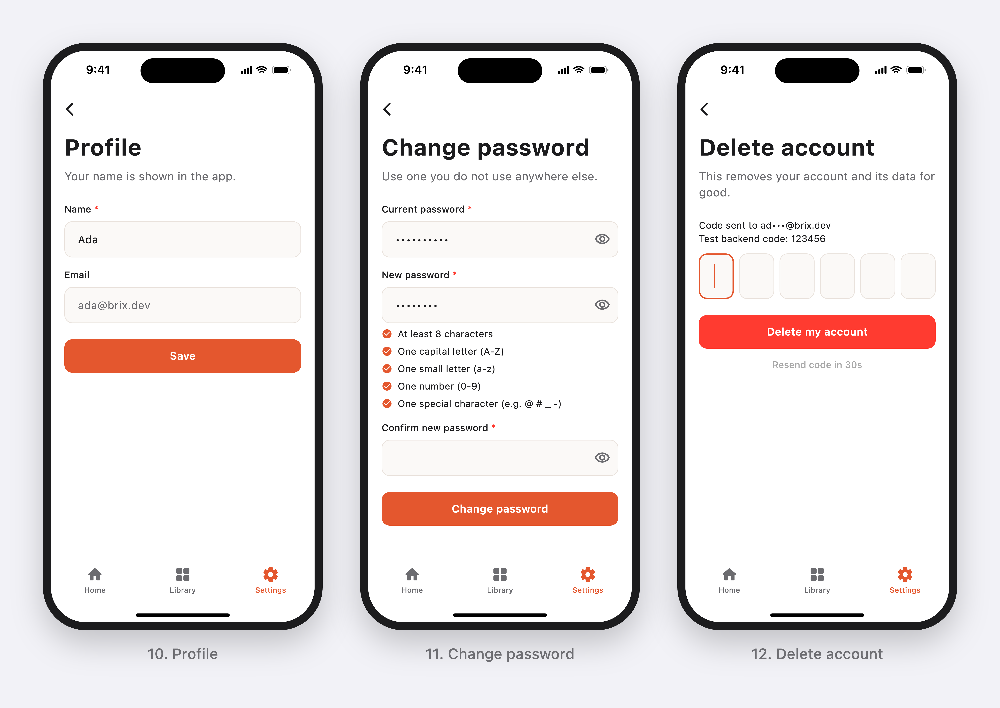
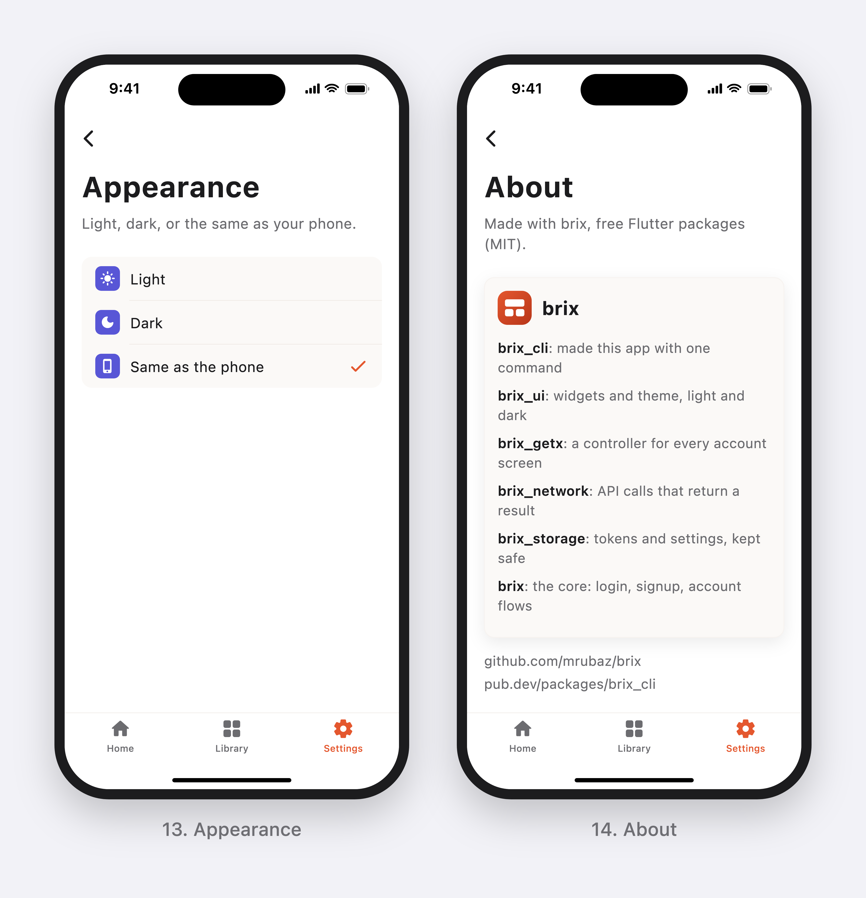
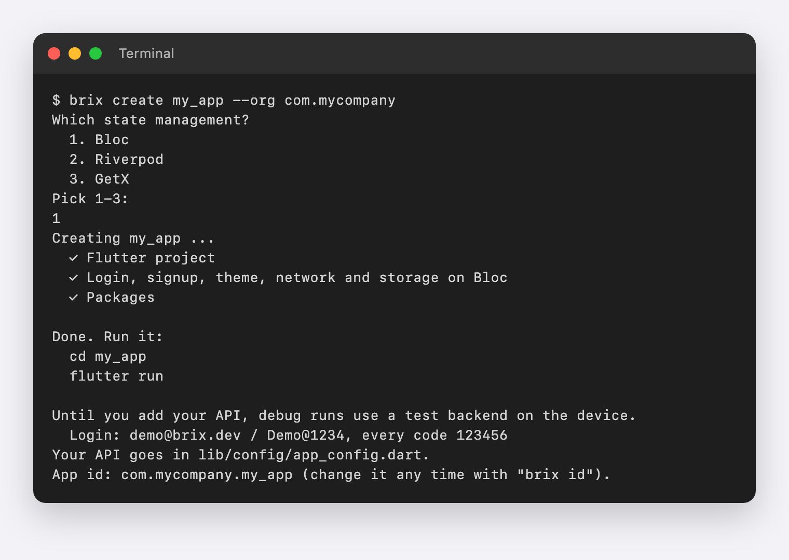
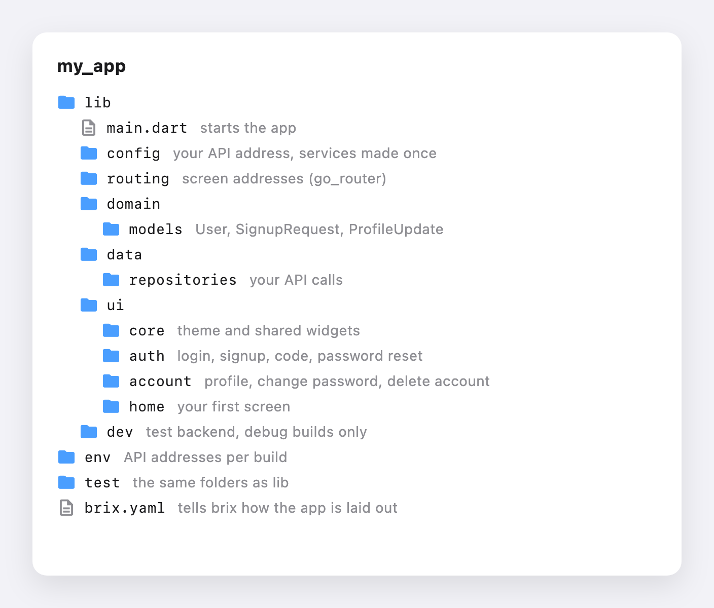

Start a Flutter app with one command: `brix create` makes an app that runs at once, with splash, login, signup, email code (OTP), forgot and reset password, profile, change password, delete account, a bottom bar, light and dark theme, API calls and safe storage. Built on Bloc, Riverpod or GetX, your choice.

[](https://pub.dev/packages/brix_cli)
[](https://github.com/mrubaz/brix/actions/workflows/ci.yml)
[](https://github.com/mrubaz/brix/blob/main/LICENSE)











## Features

- 14 screens that work on day one, in the Apple look of [brix_ui](https://pub.dev/packages/brix_ui).
- Your state library: Bloc, Riverpod or GetX. The screens are the same in each.
- A test backend on the device, so every screen works before you have a server.
- Release safe: the test backend and demo account never reach a release build.
- Folders from the [Flutter architecture guide](https://docs.flutter.dev/app-architecture/case-study): go_router, a view and view model per feature, repositories for your API.
- Staging and production addresses in `env/*.json`, with VS Code launch configs.
- Tests for the whole app, ready to run.

## Get started

1. Install the command once:

   ```bash
   dart pub global activate brix_cli
   ```

2. Make an app. Use lowercase letters, digits and underscores for the name, and your company's reverse domain for `--org`:

   ```bash
   brix create my_app --org com.mycompany
   ```

   brix asks which state library to use. There is no default: the app is built on the one you pick.

   

3. Run it:

   ```bash
   cd my_app
   flutter run
   ```

   Or press F5 in VS Code. Log in with `demo@brix.dev` and `Demo@1234` (every code is `123456`), or tap "Skip login".

4. The home screen lists the steps that make the app yours: your API address, your backend's paths and fields, your brand, and how to remove the test backend or the login.

### AI agents and scripts

Pass the state library with `--state`, so nothing waits for an answer:

```bash
brix create my_app --org com.mycompany --state riverpod
```

Without a terminal and without `--state`, brix stops and says so. It never picks a library itself, so an AI agent should ask its user which one.

## What is inside



Each screen is a short layout. The logic behind it (forms, loading, double taps, the session, error messages) comes from the brix packages, so it gets better with `flutter pub upgrade`, and none of it is copied into your app. `brix.yaml` records the state library the app is on.

## The test backend

Debug builds without an API run on a small backend that lives on the device, in `lib/dev`. It saves its accounts, so the app behaves as it would with a real server: sign up, verify, log in, change your name or password, delete the account.

Every device keeps its own copy. "Reset local backend" starts that device over, and "Skip login" jumps to the home screen.

## Safe for release

- The test backend runs only behind `kDebugMode`, so the compiler leaves it out of release builds, with its accounts, codes and buttons.
- A release build without an API, or with an address that is not `https`, opens a setup screen with the same steps instead of a login screen.
- On every change our CI makes an app for each state library, builds it for release on Android and the web, and checks that no test account or test button is inside.

## Commands

```bash
brix create <app_name> [--org com.mycompany] [--state bloc|riverpod|getx]
brix id <com.mycompany.app>    # change the app id on Android, iOS, macOS and Linux
brix --version
brix --help
```

## Not included yet

- Provider and a plain `setState` / ChangeNotifier choice in the state menu.
- Social login (Google, Apple, Facebook) and phone login.
- Desktop platforms are created by Flutter but not styled or tested by brix.

## The brix family

New app? Start here. Existing app? Take only the packages you need; each brings the core with it.

| Package | What it does |
|---|---|
| [brix_cli](https://pub.dev/packages/brix_cli) | Start here: `brix create` makes the whole app on Bloc, Riverpod or GetX |
| [brix_ui](https://pub.dev/packages/brix_ui) | Widgets and theme, light and dark |
| [brix_bloc](https://pub.dev/packages/brix_bloc) | Cubits for every account screen |
| [brix_riverpod](https://pub.dev/packages/brix_riverpod) | Riverpod notifiers for every account screen |
| [brix_getx](https://pub.dev/packages/brix_getx) | GetX controllers for every account screen |
| [brix_network](https://pub.dev/packages/brix_network) | API calls that return a result, never throw |
| [brix_storage](https://pub.dev/packages/brix_storage) | Tokens, settings and offline copies, kept safe |
| [brix](https://pub.dev/packages/brix) | The core: login, signup and account flows in pure Dart |

## Help

Questions, bugs and ideas: [GitHub issues](https://github.com/mrubaz/brix/issues).

## License

MIT
