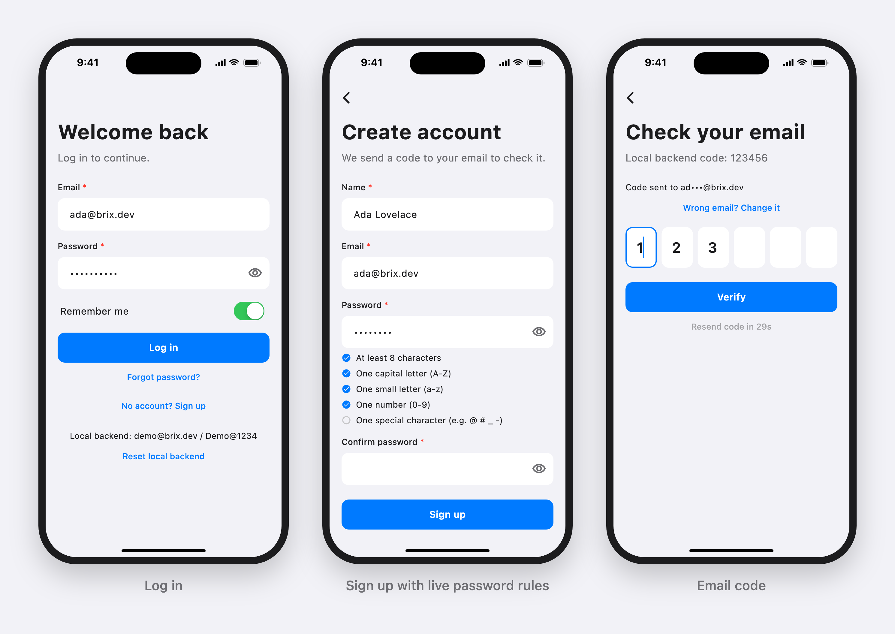
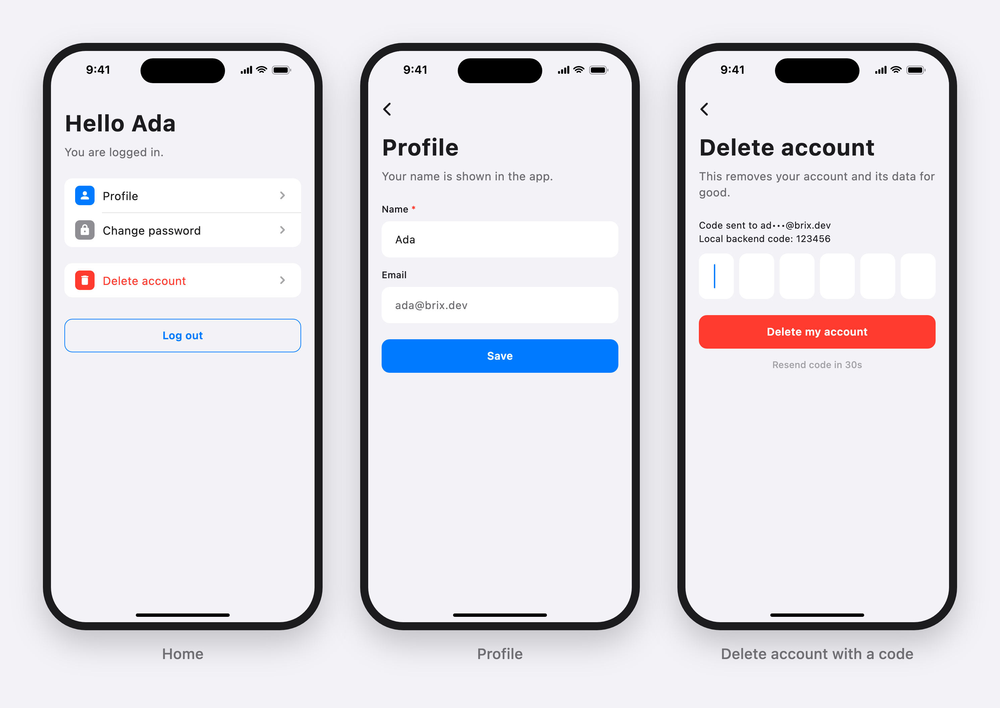

# brix_getx

[](https://pub.dev/packages/brix_cli)
[](https://pub.dev/packages/brix_ui)
[](https://pub.dev/packages/brix_getx)
[](https://pub.dev/packages/brix_network)
[](https://pub.dev/packages/brix_storage)
[](https://pub.dev/packages/brix)
[](https://github.com/mrubaz/brix/blob/main/LICENSE)

> Part of the [brix](https://github.com/mrubaz/brix) family. Starting a new app? `brix create my_app` from [brix_cli](https://pub.dev/packages/brix_cli) sets this package up for you. Adding it to an app you already have? It brings the core, [brix](https://pub.dev/packages/brix), with it.

GetX controllers for [brix](https://pub.dev/packages/brix). Each one holds the text fields, form key, loading state and clean-up code of an auth or account screen, so your screen is only its layout.

| Controller | Screen |
|---|---|
| `BrixLoginController` | login, remember me, email pre-fill |
| `BrixSignupController` | signup (you add your own fields and build the request) |
| `BrixOtpController` | code after signup: boxes, paste / autofill, auto submit, resend countdown |
| `BrixForgotPasswordController` | forgot password |
| `BrixResetPasswordController` | reset password: code boxes + new password + checklist |
| `BrixChangePasswordController` | change password |
| `BrixProfileController` | profile load / save / avatar (you add your fields) |
| `BrixDeleteAccountController` | delete account with a code |
| `BrixSessionController` | splash (`start`) and logout |





These screens come from the app that [brix_cli](https://github.com/mrubaz/brix/tree/main/packages/brix_cli) creates. Each one is only a layout on top of a brix_getx controller.

Helpers: `OtpCodeBoxes` (one box per digit), `PasswordRulesTracker` (live password checklist).

All logic lives in [brix](https://pub.dev/packages/brix), so read its README first for the four classes you write (backend, storage, navigator, alerts).

### How a screen works

```
 View (layout only)          Controller (brix_getx)             Flow (brix)
 ──────────────────          ──────────────────────             ───────────
 TextFormField ◀──────────── identifierController
 FilledButton ──tap────────▶ login() ── validates form ───────▶ LoginFlow.submit
 spinner ◀── Obx ─────────── isSubmitting ◀──── changes ──────── state
 route closed ─────────────▶ onClose: text fields + flow disposed
```

## Install

```
flutter pub add brix_getx
```

One import gives you the controllers and all of brix:

```dart
import 'package:brix_getx/brix_getx.dart';
```

## Add brix to an app you already have

This is the GetX and REST setup that [brix_cli](https://pub.dev/packages/brix_cli) uses in every new app; each piece is taken from that app. Starting from scratch? `brix create my_app` gives you all of this already.

**1. Add the packages**

```
flutter pub add brix_getx brix_network brix_storage brix_ui
```

**2. Describe your user** (add the fields your API sends)

```dart
class User {
  const User({required this.id, required this.name, required this.email});

  factory User.fromJson(Json json) => User(
    id: json.string('id'),
    name: json.string('name'),
    email: json.string('email'),
  );

  final String id;
  final String name;
  final String email;

  Map<String, Object?> toJson() => {'id': id, 'name': name, 'email': email};
}
```

**3. Write the class that knows your API** (change the paths and fields to match yours)

```dart
class AuthRepository extends AuthProvider<SignupRequest, User> {
  AuthRepository(this._api);

  final BrixApi _api;

  @override
  AuthCapabilities get capabilities =>
      const AuthCapabilities(otpAfterSignup: true, resetMode: ResetMode.otp);

  @override
  Future<Result<AuthSession<User>>> login({
    required String identifier,
    required String password,
  }) => _api.post(
    'auth/login',
    body: {'email': identifier, 'password': password},
    parse: (data) => AuthSession(
      accessToken: data.string('token'),
      user: User.fromJson(data.child('user')),
    ),
  );

  @override
  Future<Result<void>> logout() => _api.post('auth/logout');

  // register, verifyOtp, resendOtp, forgotPassword and resetPassword
  // look the same: one call each.
}
```

**4. Say where screens go**

```dart
// Start the route and return; do not wait for the new screen to close.
class AppNavigator extends AuthNavigator {
  @override
  Future<void> toHome() async {
    Get.offAllNamed('/home');
  }

  @override
  Future<void> toLogin({String? identifier}) async {
    Get.offAllNamed('/login', arguments: identifier);
  }
}
```

**5. Set everything up once** (for example in `main`)

```dart
final session = BrixSessionStore<User>(
  storage: BrixStorage(), // tokens go to the Keychain / Keystore
  userToJson: (user) => user.toJson(),
  userFromJson: (json) => User.fromJson(Json(json)),
);

late final SessionFlow<User> sessionFlow;

final api = BrixApi(
  baseUrl: 'https://your.api/v1/',
  token: () async => (await session.readSession())?.accessToken,
  logger: PrettyNetworkLogger(),
  onUnauthorized: () => sessionFlow.logout(), // once, for many 401s
);

final auth = AuthRepository(api);
final navigator = AppNavigator();
const feedback = BrixUiFeedback(); // errors as dialogs, success as toasts

sessionFlow = SessionFlow(
  auth: auth,
  store: session,
  navigator: navigator,
  feedback: feedback,
);

BrixUi.navigatorKey = Get.key; // dialogs and toasts open from controllers
```

**6. Give the login screen its controller** (a GetX binding)

```dart
GetPage(
  name: '/login',
  page: () => const LoginScreen(),
  binding: BindingsBuilder(
    () => Get.put(
      BrixLoginController<User>(
        LoginFlow(
          provider: auth,
          store: session,
          navigator: navigator,
          feedback: feedback,
        ),
      ),
    ),
  ),
)
```

**7. Build the screen**

```dart
class LoginScreen extends GetView<BrixLoginController<User>> {
  const LoginScreen({super.key});

  @override
  Widget build(BuildContext context) => Scaffold(
    body: Form(
      key: controller.formKey,
      child: Column(
        children: [
          BrixTextField(
            controller: controller.identifierController,
            label: 'Email',
            isRequired: true,
          ),
          BrixTextField(
            controller: controller.passwordController,
            label: 'Password',
            isRequired: true,
            isPassword: true,
          ),
          Obx(
            () => BrixButton(
              label: 'Log in',
              isLoading: controller.isSubmitting.value,
              onPressed: controller.login,
            ),
          ),
        ],
      ),
    ),
  );
}
```

That is the whole login. Remember me, ignoring double taps, saving the session, showing errors and opening the home screen are handled. Signup, the email code, password reset, profile and delete account follow the same pattern; the sections below show each one.

Using Firebase, Supabase or another state library? Add only `brix` and follow the [brix README](https://pub.dev/packages/brix).

## Bindings

Each route gets its controller, and the controller gets its brix flow:

```dart
GetPage(
  name: '/login',
  page: () => const LoginScreen(),
  binding: BindingsBuilder(() {
    Get.put(BrixLoginController<User>(LoginFlow(
      provider: MyAuthProvider(api),
      store: MySessionStore(),
      navigator: MyNavigator(),
      feedback: MyFeedback(),
    )));
  }),
),
```

The controller disposes its flow and text fields when the route closes.

## Login

```dart
class LoginScreen extends GetView<BrixLoginController<User>> {
  const LoginScreen({super.key});

  @override
  Widget build(BuildContext context) {
    return Form(
      key: controller.formKey,
      child: Column(children: [
        TextFormField(controller: controller.identifierController),
        Obx(() => TextFormField(
          controller: controller.passwordController,
          obscureText: controller.obscurePassword.value,
        )),
        Obx(() => Checkbox(
          value: controller.rememberMe.value,
          onChanged: (_) => controller.toggleRememberMe(),
        )),
        Obx(() => FilledButton(
          onPressed: controller.isSubmitting.value ? null : controller.login,
          child: const Text('Log in'),
        )),
      ]),
    );
  }
}
```

"Remember me" fills the form on open. After a reset or a verified signup, call `controller.prefillIdentifier(email)` to fill the email.

## Signup

Add your own fields and say how the request is built:

```dart
class SignupController extends BrixSignupController<SignupBody, User> {
  SignupController(super.flow);

  final nameController = TextEditingController();
  final acceptedTerms = false.obs;

  @override
  SignupBody buildRequest({required String identifier, required String password}) =>
      SignupBody(name: nameController.text.trim(), email: identifier, password: password);

  /// Your own checks before the call.
  @override
  Future<bool> beforeSubmit() async {
    if (acceptedTerms.value) return true;
    Get.snackbar('Terms', 'Please accept the terms.');
    return false;
  }

  @override
  void onClose() {
    nameController.dispose();
    super.onClose();
  }
}
```

In the view: `identifierController`, `passwordController`, `confirmPasswordController`, `signup()`, `isSubmitting`, and the checklist from `passwordRules`:

```dart
Obx(() => Column(children: [
  for (final rule in controller.passwordRules.rules)
    Row(children: [
      Icon(controller.passwordRules.unmet.contains(rule)
          ? Icons.radio_button_unchecked
          : Icons.check_circle),
      Text(rule.labelFor(controller.passwordRules.policy)),
    ]),
]))
```

## Code screen (after signup)

```dart
class OtpScreen extends GetView<BrixOtpController<User>> {
  const OtpScreen({super.key});

  @override
  Widget build(BuildContext context) {
    final boxes = controller.boxes;
    return Column(children: [
      Obx(() => Text('Code sent to ${controller.maskedIdentifier.value}')),
      Row(children: [
        for (var i = 0; i < boxes.length; i++)
          Expanded(child: TextField(
            controller: boxes.controllers[i],
            focusNode: boxes.focusNodes[i],
            keyboardType: TextInputType.number,
            autofillHints: i == 0 ? const [AutofillHints.oneTimeCode] : null,
            onChanged: (value) => boxes.onDigitChanged(i, value),
          )),
      ]),
      Obx(() => TextButton(
        onPressed: controller.resendSeconds.value > 0 ? null : controller.resend,
        child: Text(controller.resendSeconds.value > 0
            ? 'Resend in ${controller.resendSeconds.value}s'
            : 'Resend code'),
      )),
      TextButton(onPressed: controller.changeIdentifier, child: const Text('Change email')),
    ]);
  }
}
```

Typing or pasting the last digit verifies at once; a wrong code clears the boxes.

## Forgot and reset password

```dart
// Forgot: identifierController, submit(), isSubmitting.
Get.put(BrixForgotPasswordController(ForgotPasswordFlow(
  provider: provider, navigator: navigator, feedback: feedback,
)));

// Reset: the email comes from the route.
Get.put(BrixResetPasswordController(ResetPasswordFlow(
  provider: provider,
  navigator: navigator,
  feedback: feedback,
  identifier: Get.arguments as String,
  store: store,
)));
```

The reset screen uses the same `boxes`, `resendSeconds`, `resend()` and `changeIdentifier()` as the code screen, plus `formKey`, `newPasswordController`, `newPasswordFocus` (focused when the code is complete), `obscureNewPassword`, `passwordRules` and `submit()`.

## Splash and logout

```dart
Get.put(BrixSessionController<User>(SessionFlow(
  auth: provider, store: store, navigator: navigator, feedback: feedback,
)));

// Splash, after the first frame:
Get.find<BrixSessionController<User>>().start();

// Logout button:
Obx(() => TextButton(
  onPressed: controller.isLoggingOut.value ? null : controller.logout,
  child: const Text('Log out'),
))
```

## Account screens

```dart
// Change password: currentPasswordController, newPasswordController,
// confirmPasswordController, passwordRules, submit(), isSubmitting.
Get.put(BrixChangePasswordController(ChangePasswordFlow(
  account: account, store: store, navigator: navigator, feedback: feedback,
)));

// Delete account: requestDeletion() sends the code, then isCodeSent shows
// the boxes; confirm() deletes. isRequesting / isSubmitting for loaders.
Get.put(BrixDeleteAccountController(DeleteAccountFlow(
  account: account, store: store, navigator: navigator, feedback: feedback,
  identifier: currentUser.email,
)));
```

Profile, add your fields:

```dart
class ProfileController extends BrixProfileController<User, ProfileBody> {
  ProfileController(super.flow);

  final nameController = TextEditingController();

  @override
  void onUserLoaded(User user, {required bool fillForm}) {
    if (fillForm) nameController.text = user.name;
  }

  @override
  ProfileBody buildUpdate() => ProfileBody(name: nameController.text.trim());

  @override
  bool canSave() => nameController.text.trim() != user.value?.name;

  @override
  void onClose() {
    nameController.dispose();
    super.onClose();
  }
}
```

The view uses `formKey`, `isLoading`, `loadFailed` (with `load()` as retry), `isSaving`, `save()`, and `uploadAvatar(AvatarUpload(...))` / `isUploadingAvatar`.

## Example app

[example/](https://github.com/mrubaz/brix/tree/main/packages/brix_getx/example): login, signup with a code, forgot / reset password and logout on an in-memory demo backend. No server needed:

```
cd example
flutter run
```

Demo account `demo@brix.dev` / `Demo@1234`, every code `123456`.

## License

MIT

## The brix packages

brix_getx is one part of [brix](https://github.com/mrubaz/brix). New app? Start with [brix_cli](https://pub.dev/packages/brix_cli). Existing app? Take only the packages you need; each brings the core with it.

| Package | Version | What it does |
|---|---|---|
| [brix_cli](https://pub.dev/packages/brix_cli) | [](https://pub.dev/packages/brix_cli) | `brix create my_app`: a new app on every package below. Start here |
| [brix_ui](https://pub.dev/packages/brix_ui) | [](https://pub.dev/packages/brix_ui) | Buttons, fields, select, sheets, dialogs, toasts, light and dark |
| [brix_getx](https://pub.dev/packages/brix_getx) | [](https://pub.dev/packages/brix_getx) | GetX controllers for every account screen |
| [brix_network](https://pub.dev/packages/brix_network) | [](https://pub.dev/packages/brix_network) | REST calls that return a `Result` |
| [brix_storage](https://pub.dev/packages/brix_storage) | [](https://pub.dev/packages/brix_storage) | Values, secrets and a session store |
| [brix](https://pub.dev/packages/brix) | [](https://pub.dev/packages/brix) | The core every package builds on: flows, `Result`, `Json`, `BrixLogger` |
