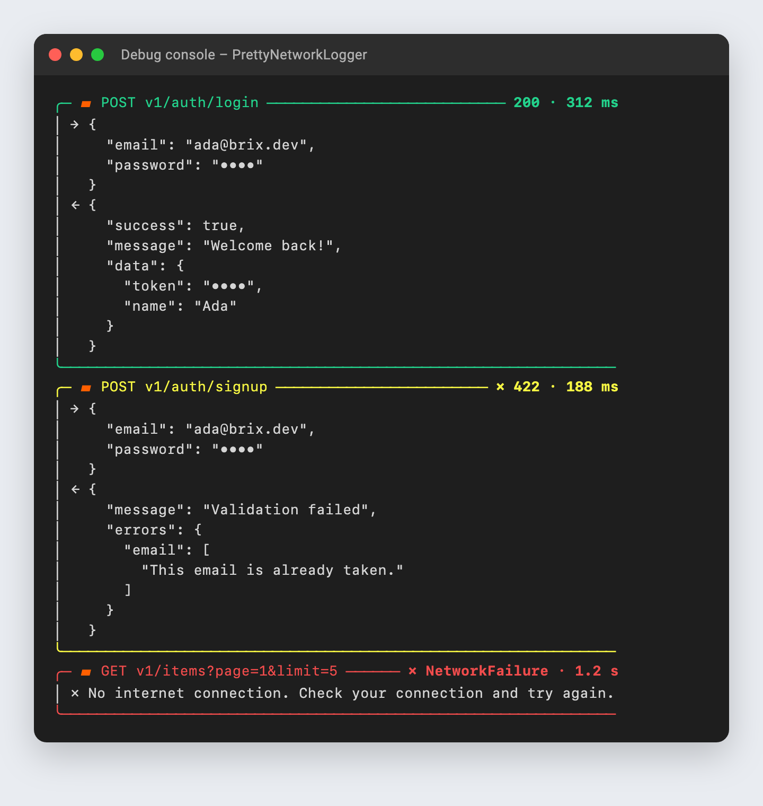

# brix_network

[](https://pub.dev/packages/brix)
[](https://pub.dev/packages/brix_getx)
[](https://pub.dev/packages/brix_network)
[](https://pub.dev/packages/brix_storage)
[](https://pub.dev/packages/brix_ui)
[](https://pub.dev/packages/brix_cli)
[](https://github.com/mrubaz/brix/blob/main/LICENSE)

REST calls without the boilerplate. Every call returns a `Result`: either your data as a model, or a `Failure` with the backend's messages and field errors. There are no exceptions to catch and no global error list.

It uses Dio by default, and you can plug in any other client (`http`, `chopper` or a fake in tests).

It reads common API shapes out of the box: `{success, message, data, errors}` style APIs (Node, NestJS, Laravel and most custom ones), FastAPI and Django REST. For anything else you write your own small reader.

It is careful. Only safe requests are retried (GET, PUT and DELETE), many 401 answers at once log out only once, and passwords, tokens and API keys never reach the log.

It handles files too. `download` gives you a PDF, image or spreadsheet as bytes, with its type and file name.

In debug builds every call is printed in a readable box; in release builds nothing is printed.



Using Firebase or Supabase? You do not need this package. Use their SDKs together with [brix](https://pub.dev/packages/brix).

### What happens in a call

```
 api.get('users', parse: User.fromJson)
   │
   ├─ URL = baseUrl + path + query, headers + Bearer token
   ├─ NetworkClient.send  (Dio: timeout, retry for GET/PUT/DELETE, cancel)
   │     └─ no connection / timeout ─────────────────────▶ Failed(NetworkFailure)
   ├─ ResponseReader.read  ─▶ data, message, messages, fieldErrors
   ├─ 2xx and success != false ─▶ parse(Json) ───────────▶ Success(User, message)
   └─ otherwise ─▶ statusMapper ─▶ Failed(Validation / Unauthorized / Server …)
                        └─ 401 ─▶ onUnauthorized (once for many calls)
   every call ─▶ NetworkLogger (secrets hidden)
```

## Install

```
dart pub add brix_network
```

```dart
import 'package:brix_network/brix_network.dart'; // also brings Result, Failure, Json
```

## Set up once

```dart
final api = BrixApi(
  baseUrl: 'https://api.example.com/v1/',
  token: () => secureStorage.read(key: 'token'),   // sent as "Authorization: Bearer …"
  onUnauthorized: () => sessionFlow.logout(),       // once, however many calls get a 401
  logoutOn401: (path) => path != 'auth/login',      // a wrong password is no logout
  logger: PrettyNetworkLogger(),
);
```

## Calls

```dart
// One object
final Result<User> profile = await api.get('auth/profile', parse: User.fromJson);

// A list
final Result<List<Item>> items = await api.get(
  'items',
  query: {'page': 1, 'status': status},          // null values are left out
  parse: (data) => data.items(Item.fromJson),
);

// No data back
final Result<void> saved = await api.patch('auth/profile', body: update.toJson());

// Upload (field name is your backend's)
final Result<void> avatar = await api.upload(
  'auth/profile/avatar',
  method: HttpMethod.patch,
  files: [UploadFile.path('avatar', file.path)],
  onProgress: (sent, total) => progress.value = sent / total,
);

// A file (PDF, image, spreadsheet): bytes + type + name from the server
final Result<DownloadedFile> pdf = await api.download(
  'documents/url',
  query: {'key': documentKey},
  onProgress: (received, total) => progress.value = received / total,
);
// pdf.data.bytes, .contentType ('application/pdf'), .fileName, .isPdf, .sizeLabel

// Another API (absolute URL, no token)
await api.get('https://maps.example.com/geocode', query: {'key': mapsKey}, withToken: false);
```

Models read their JSON with brix's `Json`, no crashes on a missing key or a number sent as text:

```dart
factory User.fromJson(Json json) => User(
  id: json.string('id'),
  name: json.string('profile.firstName'),
  createdAt: json.dateOrNull('createdAt'),
);
```

## Using the result

```dart
switch (await repository.getProfile()) {
  case Success(:final data, :final message):
    user.value = data;
  case Failed(:final failure):
    showError(failure.displayMessage);            // backend text, else a plain default
}
```

Errors per form field (`{"errors": {"email": ["Already registered"]}}`):

```dart
TextFormField(decoration: InputDecoration(errorText: failure?.fieldError('email')))
```

| Status | Failure |
|---|---|
| 400, 409, 422 | `ValidationFailure` (with `fieldErrors`) |
| 401 | `UnauthorizedFailure` (runs `onUnauthorized`) |
| 408, 504, no connection, timeout | `NetworkFailure` |
| 403, 404, 5xx, `success: false` | `ServerFailure(statusCode)` |
| cancelled | `CancelledFailure` (usually show nothing) |

Change it with `statusMapper: (status, reply) => ...` (call `StandardStatus.map` for the rest).

## Your backend's answer shape

```dart
BrixApi(baseUrl: url, reader: const ResponseReader.envelope());   // default
BrixApi(baseUrl: url, reader: const ResponseReader.fastApi());    // {detail: …}
BrixApi(baseUrl: url, reader: const ResponseReader.djangoRest()); // {field: [...], non_field_errors}

// Other keys or nested errors:
const ResponseReader.envelope(
  dataKey: 'result',
  messageKey: 'msg',
  errorKeys: ['errors', 'data.errors', 'data.fieldErrors'],
);

// Fully your own:
ResponseReader.custom((response) => ApiReply(
  data: (response.body as Map)['payload'],
  messages: [...],
));
```

## Console log

Every call gets its own box. It is green when the call worked, yellow for a 4xx answer and red for a 5xx or no connection (see the picture at the top). Passwords and tokens are hidden.

`PrettyNetworkLogger(colors: false)` for the Xcode console, `hiddenKeys: {'pin_code'}` for more secrets, `maxLines` to cut bodies. Or send logs elsewhere: `class MyLogger extends NetworkLogger { void log(NetworkLogEntry entry) { ... } }`.

## Cancel a call

```dart
final cancel = RequestCancel();
api.get('reports', cancel: cancel);
// screen closed:
cancel.cancel(); // → Failed(CancelledFailure())
```

## Another HTTP client

```dart
class HttpPackageClient extends NetworkClient {
  @override
  Future<NetworkResponse> send(NetworkRequest request) async {
    // send with package:http; return every status (also 4xx / 5xx),
    // throw NetworkFailure() when the server could not be reached.
  }
}

BrixApi(baseUrl: url, client: HttpPackageClient());
```

Dio settings (interceptors, certificates, proxy): `DioNetworkClient(dio: myDio, timeout: Duration(seconds: 30), retries: 2)`.

## Testing

Give `BrixApi` a fake client and answer with whatever the test needs:

```dart
class FakeClient extends NetworkClient {
  @override
  Future<NetworkResponse> send(NetworkRequest request) async =>
      const NetworkResponse(statusCode: 200, body: {'data': {'id': 'u1'}});
}
```

## License

MIT

## The brix packages

brix_network is one part of [brix](https://github.com/mrubaz/brix). Take only the packages you need.

| Package | Version | What it does |
|---|---|---|
| [brix](https://pub.dev/packages/brix) | [](https://pub.dev/packages/brix) | The logic: auth, account, `Result`, `Json`, `BrixLogger` |
| [brix_getx](https://pub.dev/packages/brix_getx) | [](https://pub.dev/packages/brix_getx) | GetX controllers for every brix screen |
| [brix_network](https://pub.dev/packages/brix_network) | [](https://pub.dev/packages/brix_network) | REST calls that return a `Result` |
| [brix_storage](https://pub.dev/packages/brix_storage) | [](https://pub.dev/packages/brix_storage) | Values, secrets and a session store |
| [brix_ui](https://pub.dev/packages/brix_ui) | [](https://pub.dev/packages/brix_ui) | Buttons, fields, select, dialogs, sheets, toasts |
| [brix_cli](https://pub.dev/packages/brix_cli) | [](https://pub.dev/packages/brix_cli) | `brix create my_app`: a new app on all of them |
