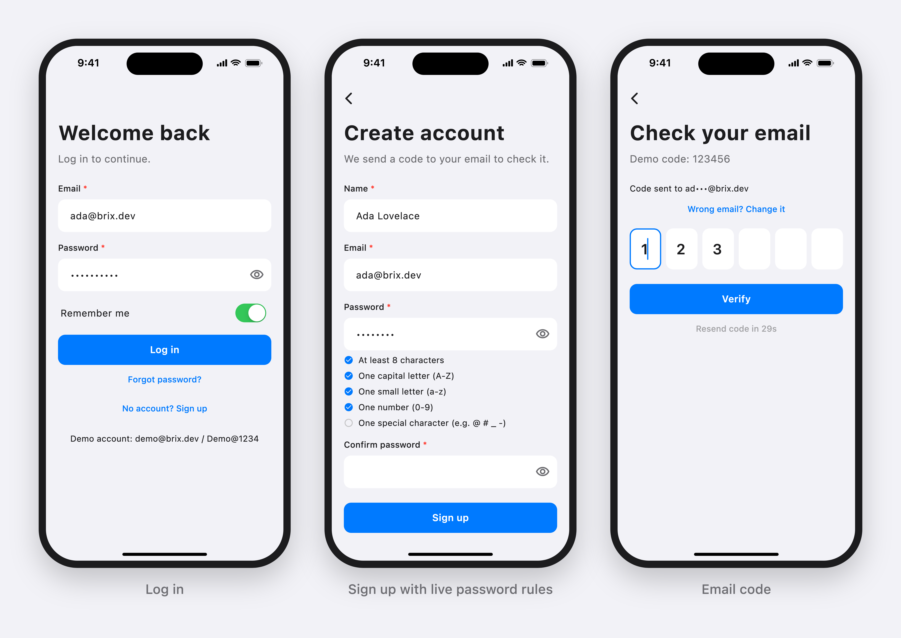
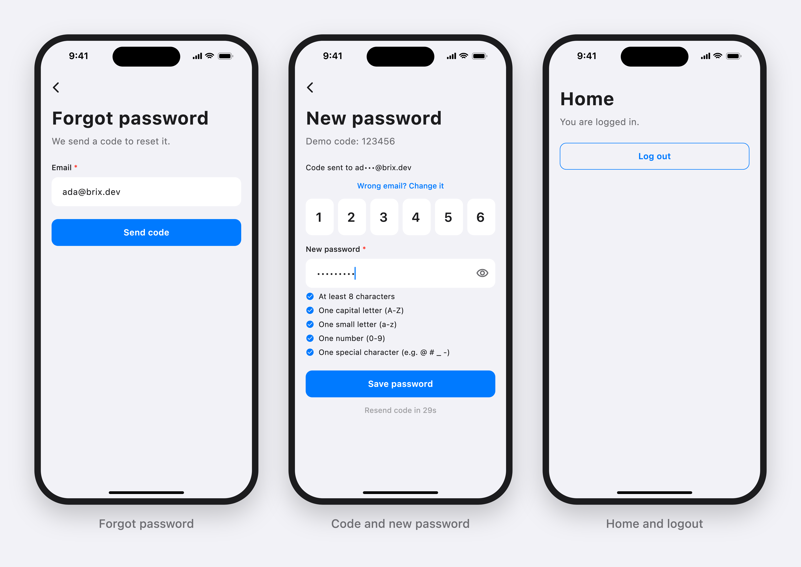

# brix_riverpod

[](https://pub.dev/packages/brix_cli)
[](https://pub.dev/packages/brix_ui)
[](https://pub.dev/packages/brix_getx)
[](https://pub.dev/packages/brix_riverpod)
[](https://pub.dev/packages/brix_network)
[](https://pub.dev/packages/brix_storage)
[](https://pub.dev/packages/brix)
[](https://github.com/mrubaz/brix/blob/main/LICENSE)

> Part of the [brix](https://github.com/mrubaz/brix) family. It brings the core, [brix](https://pub.dev/packages/brix), with it.

Riverpod 3 notifiers for [brix](https://pub.dev/packages/brix). Each one holds the text fields, form key, state and clean-up code of an auth or account screen, so your screen is only its layout.

| Notifier | State | Screen |
|---|---|---|
| `BrixLoginNotifier` | `BrixLoginState` | login, remember me, email pre-fill |
| `BrixSignupNotifier` | `BrixSignupState` | signup (you add your own fields and build the request) |
| `BrixOtpNotifier` | `CodeEntryState` | code after signup: boxes, paste / autofill, auto submit, resend countdown |
| `BrixForgotPasswordNotifier` | `AuthFormState` | forgot password |
| `BrixResetPasswordNotifier` | `BrixResetPasswordState` | reset password: code boxes, new password, unmet rules |
| `BrixChangePasswordNotifier` | `BrixChangePasswordState` | change password |
| `BrixProfileNotifier` | `ProfileState` | profile load, save and avatar (you add your fields) |
| `BrixDeleteAccountNotifier` | `CodeEntryState` | delete account with a code |
| `BrixSessionNotifier` | `SessionState` | splash (`start`) and logout |

Every state is immutable. Watch it for loaders, toggles and the password checklist; call methods on the notifier.





These screens come from the [example app](example). Each one is only a layout on top of a brix_riverpod notifier.

All logic lives in [brix](https://pub.dev/packages/brix), so read its README first for the four classes you write (backend, storage, navigator, alerts).

## Install

```
flutter pub add brix_riverpod flutter_riverpod
```

One import gives you brix too:

```dart
import 'package:brix_riverpod/brix_riverpod.dart';
```

## How a notifier gets its flow

A Riverpod notifier takes no constructor arguments, so you extend the brix notifier and return your flow from `createFlow`. Build the flow from your own providers:

```dart
final backendProvider = Provider((ref) => MyAuthProvider());
final sessionStoreProvider = Provider((ref) => MySessionStore());
final navigatorProvider = Provider((ref) => MyNavigator());
final feedbackProvider = Provider((ref) => MyFeedback());

class LoginNotifier extends BrixLoginNotifier<User> {
  @override
  LoginFlow<User> createFlow() => LoginFlow(
    provider: ref.read(backendProvider),
    store: ref.read(sessionStoreProvider),
    navigator: ref.read(navigatorProvider),
    feedback: ref.read(feedbackProvider),
  );
}

final loginProvider =
    NotifierProvider.autoDispose<LoginNotifier, BrixLoginState>(
      LoginNotifier.new,
    );
```

Use `autoDispose`: the notifier, its flow and its text fields are disposed when the screen closes.

## Login

```dart
class LoginScreen extends ConsumerWidget {
  const LoginScreen({super.key});

  @override
  Widget build(BuildContext context, WidgetRef ref) {
    final state = ref.watch(loginProvider);
    final login = ref.read(loginProvider.notifier);
    return Form(
      key: login.formKey,
      child: Column(
        children: [
          TextFormField(controller: login.identifierController),
          TextFormField(
            controller: login.passwordController,
            obscureText: state.obscurePassword,
          ),
          Checkbox(
            value: state.rememberMe,
            onChanged: (_) => login.toggleRememberMe(),
          ),
          FilledButton(
            onPressed: state.isSubmitting ? null : login.login,
            child: const Text('Log in'),
          ),
        ],
      ),
    );
  }
}
```

Saved "remember me" details fill the form on their own. `prefillIdentifier(email)` fills the email after a signup or a reset.

## Your own fields

Make extra text fields in `initFields` and dispose them in `disposeFields`, not as `final` fields. Riverpod can keep the same notifier across a rebuild; brix makes the fields again with the new flow.

```dart
class SignupNotifier extends BrixSignupNotifier<SignupBody, User> {
  late TextEditingController nameController;

  @override
  SignupFlow<SignupBody, User> createFlow() => SignupFlow(/* ... */);

  @override
  void initFields() {
    super.initFields();
    nameController = TextEditingController();
  }

  @override
  void disposeFields() {
    nameController.dispose();
    super.disposeFields();
  }

  @override
  SignupBody buildRequest({
    required String identifier,
    required String password,
  }) => SignupBody(name: nameController.text.trim(), email: identifier, password: password);
}
```

Override `beforeSubmit` for your own checks, such as accepted terms.

## Code screens

`BrixOtpNotifier`, `BrixResetPasswordNotifier` and `BrixDeleteAccountNotifier` have `boxes` (`OtpCodeBoxes`): one text field and focus node per digit, with typing, paste, autofill and delete handled. A rejected code clears them.

- OTP starts its flow right after the build and submits on the last digit.
- Reset moves focus to `newPasswordFocus` on the last digit. Opened without an email, it goes back to login.
- Delete account never submits on its own. `requestDeletion` sends the code (`state.isRequesting` while it goes), `confirm` deletes.

The reset screen needs the email the code was sent to. A family provider passes it:

```dart
class ResetPasswordNotifier extends BrixResetPasswordNotifier {
  ResetPasswordNotifier(this.identifier);
  final String identifier;

  @override
  ResetPasswordFlow createFlow() => ResetPasswordFlow(
    identifier: identifier,
    /* ... */
  );
}

final resetPasswordProvider = NotifierProvider.autoDispose
    .family<ResetPasswordNotifier, BrixResetPasswordState, String>(
      ResetPasswordNotifier.new,
    );
```

## Password checklist

Signup, reset and change password keep the rules the typed password does not meet yet in their state:

```dart
for (final rule in notifier.passwordRules)
  Text(
    rule.labelFor(notifier.flow.passwordPolicy),
    style: state.unmetPasswordRules.contains(rule) ? muted : done,
  ),
```

`state.passwordRulesMet` is true once every rule is met.

## Splash and logout

```dart
// Splash: after the first frame.
ref.read(sessionProvider.notifier).start();

// Logout button.
FilledButton(
  onPressed: ref.watch(sessionProvider).isLoggingOut
      ? null
      : ref.read(sessionProvider.notifier).logout,
  child: const Text('Log out'),
);
```

## Profile

`BrixProfileNotifier` starts as loading and loads right after the build. Fill your fields in `onUserLoaded`, return your body from `buildUpdate` and say whether anything changed in `canSave`. `uploadAvatar` keeps unsaved typing.

## Example app

[`example/`](example) is a full app on a demo backend (no server): login, signup, code, forgot and reset password, logout. Demo account `demo@brix.dev` / `Demo@1234`, every code `123456`.

```
cd example && flutter run
```

## License

MIT
