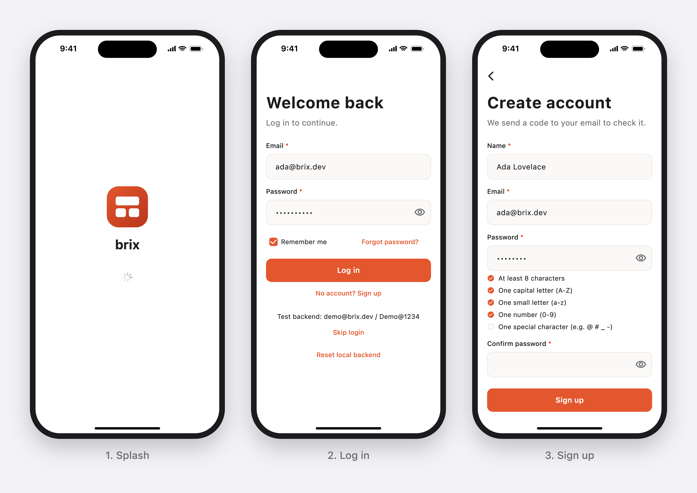
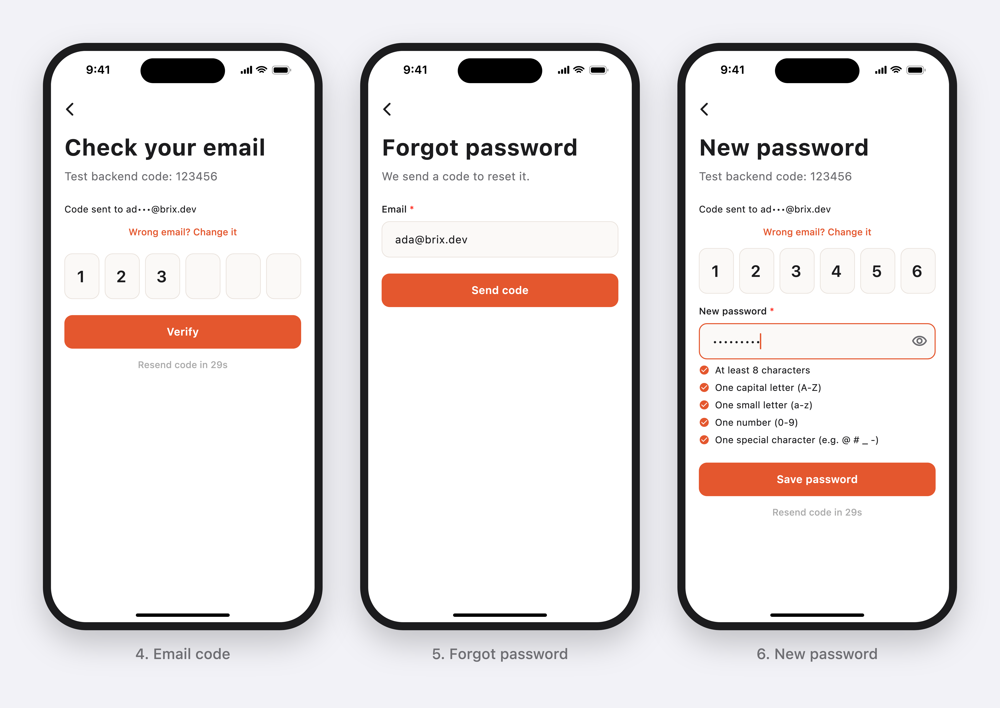

Riverpod 3 notifiers for every account screen of a Flutter app: login, signup, email code (OTP), forgot and reset password, profile, change password, delete account, splash and logout. Each holds an immutable state and the methods a screen calls; the logic comes from [brix](https://pub.dev/packages/brix).

[](https://pub.dev/packages/brix_riverpod)
[](https://github.com/mrubaz/brix/actions/workflows/ci.yml)
[](https://github.com/mrubaz/brix/blob/main/LICENSE)





Starting a new app? `brix create my_app` from [brix_cli](https://pub.dev/packages/brix_cli) makes these screens on Riverpod for you.

## Features

- One `Notifier` per screen, used with `NotifierProvider.autoDispose`.
- No Flutter objects inside, as the Riverpod docs recommend: your screen owns its text fields, form key and code boxes.
- Immutable states with `copyWith` and `==` (Equatable), so `ref.watch` redraws only on a real change.
- Remember me, email pre-fill after signup or reset, show / hide password.
- Live password rules for signup, reset and change password.
- Code screens with resend countdown, a failed attempt counter and `OtpCodeBoxes` (paste, autofill, auto submit).
- Works with any backend: you write the adapters once in brix.

| Notifier | State | Screen |
|---|---|---|
| `BrixLoginNotifier` | `BrixLoginState` | login, remember me, email pre-fill |
| `BrixSignupNotifier` | `BrixSignupState` | signup (you add your own values and build the request) |
| `BrixOtpNotifier` | `CodeEntryState` | code after signup |
| `BrixForgotPasswordNotifier` | `BrixForgotPasswordState` | forgot password |
| `BrixResetPasswordNotifier` | `BrixResetPasswordState` | code and new password |
| `BrixChangePasswordNotifier` | `BrixChangePasswordState` | change password |
| `BrixProfileNotifier` | `ProfileState` | profile load, save and avatar |
| `BrixDeleteAccountNotifier` | `CodeEntryState` | delete account with a code |
| `BrixSessionNotifier` | `SessionState` | splash (`start`) and logout |

## Install

```bash
flutter pub add brix_riverpod flutter_riverpod
```

One import gives you brix too:

```dart
import 'package:brix_riverpod/brix_riverpod.dart';
```

The logic lives in [brix](https://pub.dev/packages/brix); read its README for the four classes you write once (backend, session store, navigator, alerts).

## Usage

### Give each notifier its flow

A notifier takes no constructor arguments, so extend the brix notifier and return the flow from `createFlow`:

```dart
class LoginViewModel extends BrixLoginNotifier<User> {
  @override
  LoginFlow<User> createFlow() => LoginFlow(
    provider: ref.read(backendProvider),
    store: ref.read(sessionStoreProvider),
    navigator: ref.read(navigatorProvider),
    feedback: ref.read(feedbackProvider),
  );
}

final loginProvider =
    NotifierProvider.autoDispose<LoginViewModel, BrixLoginState>(
      LoginViewModel.new,
    );
```

Wrap your app in `ProviderScope`. With `autoDispose`, the notifier and its flow are disposed when the screen closes.

### A screen

The screen owns its fields, sends what is typed, checks its form, then calls the notifier:

```dart
class _LoginScreenState extends ConsumerState<LoginScreen> {
  final _formKey = GlobalKey<FormState>();
  final _email = TextEditingController();
  final _password = TextEditingController();

  @override
  void dispose() {
    _email.dispose();
    _password.dispose();
    super.dispose();
  }

  @override
  Widget build(BuildContext context) {
    // Remembered details and a pre-filled email arrive in the state.
    ref.listen(loginProvider, (_, state) {
      if (_email.text != state.identifier) _email.text = state.identifier;
      if (_password.text != state.password) _password.text = state.password;
    });
    final state = ref.watch(loginProvider);
    final login = ref.read(loginProvider.notifier);
    return Form(
      key: _formKey,
      child: Column(
        children: [
          TextFormField(controller: _email, onChanged: login.identifierChanged),
          TextFormField(
            controller: _password,
            onChanged: login.passwordChanged,
            obscureText: state.obscurePassword,
          ),
          FilledButton(
            onPressed: state.isSubmitting
                ? null
                : () {
                    if (_formKey.currentState!.validate()) login.login();
                  },
            child: const Text('Log in'),
          ),
        ],
      ),
    );
  }
}
```

`prefillIdentifier(email)` fills the email after a signup or a reset; the password is filled only for the remembered account.

### Your own values

Keep extra values in your notifier and build your request:

```dart
class SignupViewModel extends BrixSignupNotifier<SignupRequest, User> {
  String _name = '';

  @override
  SignupFlow<SignupRequest, User> createFlow() => SignupFlow(/* ... */);

  void nameChanged(String value) => _name = value;

  @override
  SignupRequest buildRequest({
    required String identifier,
    required String password,
  }) => SignupRequest(name: _name.trim(), email: identifier, password: password);
}
```

Override `beforeSubmit` for your own checks, such as accepted terms.

### Code screens

The screen owns an `OtpCodeBoxes` (one field and focus node per digit) and passes the code on:

```dart
late final _boxes = OtpCodeBoxes(
  length: ref.read(otpProvider.notifier).otpLength,
  onCompleted: () => ref.read(otpProvider.notifier).verify(_boxes.code),
);

// In build: a rejected code clears the boxes.
ref.listen(otpProvider, (before, now) {
  if (before != null && now.failedAttempts != before.failedAttempts) {
    _boxes.clear();
  }
});
```

- OTP and reset start their flow right after the build. Reset opened without an email goes back to login.
- Reset takes the code with the new password: `submit(_boxes.code)`.
- Delete account never deletes on its own: `requestDeletion()` sends the code, `confirm(code)` deletes.

Reset and delete account need the email the code went to; a family provider passes it:

```dart
final resetPasswordProvider = NotifierProvider.autoDispose
    .family<ResetPasswordViewModel, BrixResetPasswordState, String>(
      ResetPasswordViewModel.new,
    );
```

### Password checklist

Signup, reset and change password keep the rules the typed password does not meet yet:

```dart
for (final rule in notifier.passwordRules)
  Text(
    rule.labelFor(notifier.flow.passwordPolicy),
    style: state.unmetPasswordRules.contains(rule) ? muted : done,
  ),
```

### Profile, splash and logout

- `BrixProfileNotifier` starts as loading and loads right after the build. Fill your fields the first time `state.user` arrives, then call `save(yourUpdate)`. `uploadAvatar` keeps unsaved typing.
- Splash: `ref.read(sessionProvider.notifier).start()` after the first frame.
- Logout: `ref.read(sessionProvider.notifier).logout()`, with `state.isLoggingOut` for the loader.

## Example app

[`example/`](https://github.com/mrubaz/brix/tree/main/packages/brix_riverpod/example) is the app `brix create --state riverpod` makes: 14 screens on a test backend on the device, no server needed. Log in with `demo@brix.dev` / `Demo@1234`; every code is `123456`.

```bash
cd example && flutter run
```

## Not included yet

- Social login (Google, Apple, Facebook) and phone login.
- Code generation (`@riverpod`): the notifiers are plain classes, so you can wrap them in generated providers yourself.

## The brix family

| Package | What it does |
|---|---|
| [brix_cli](https://pub.dev/packages/brix_cli) | Start here: `brix create` makes the whole app on Bloc, Riverpod or GetX |
| [brix_ui](https://pub.dev/packages/brix_ui) | Widgets and theme, light and dark |
| [brix_bloc](https://pub.dev/packages/brix_bloc) | Cubits for every account screen |
| [brix_riverpod](https://pub.dev/packages/brix_riverpod) | Riverpod notifiers for every account screen |
| [brix_getx](https://pub.dev/packages/brix_getx) | GetX controllers for every account screen |
| [brix_network](https://pub.dev/packages/brix_network) | API calls that return a result, never throw |
| [brix_storage](https://pub.dev/packages/brix_storage) | Tokens, settings and offline copies, kept safe |
| [brix](https://pub.dev/packages/brix) | The core: login, signup and account flows in pure Dart |

## Help

Questions, bugs and ideas: [GitHub issues](https://github.com/mrubaz/brix/issues).

## License

MIT
