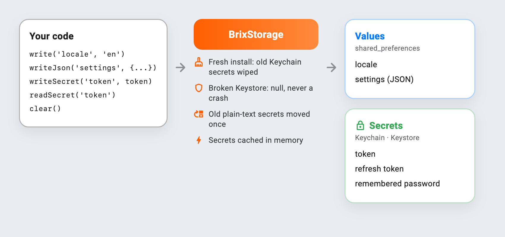

Local storage that handles the tricky parts for you: plain values, secrets, and a ready session store for [brix](https://pub.dev/packages/brix).

[](https://pub.dev/packages/brix_storage)
[](https://github.com/mrubaz/brix/actions/workflows/ci.yml)
[](https://github.com/mrubaz/brix/blob/main/LICENSE)



Starting a new app? `brix create my_app` from [brix_cli](https://pub.dev/packages/brix_cli) sets brix_storage up for you.

## Features

- Values go to `shared_preferences` and secrets to the Keychain or Keystore (through `flutter_secure_storage`), all behind one class.
- It is safe after a reinstall. iOS keeps Keychain items when an app is deleted, so a new install could log in as the last user. brix_storage clears them on a fresh install.
- It never crashes on a broken Keystore, which can happen on Android after a backup restore. The read simply returns `null` and the error goes to `onError`.
- It moves old plain-text secrets into secure storage the first time they are read.
- `BrixSessionStore` is a complete brix `AuthSessionStore`: tokens and the remembered password are kept as secrets and the user as JSON.

## Install

```bash
flutter pub add brix_storage
```

## Use

```dart
final storage = BrixStorage(onError: (error, stack) => log('storage: $error'));

await storage.write('locale', 'en');
await storage.writeJson('settings', {'darkMode': true});
await storage.writeSecret('token', token);   // Keychain / Keystore

final token = await storage.readSecret('token');      // cached in memory after the first read
final settings = await storage.readJson('settings');  // null if missing or broken

await storage.clear(); // everything, e.g. after deleting the account
```

### Session store for brix flows

```dart
final store = BrixSessionStore<User>(
  storage: storage,
  userToJson: (user) => user.toJson(),
  userFromJson: User.fromJson,
);

LoginFlow(provider: auth, store: store, navigator: nav, feedback: alerts);
```

| Call | Keeps |
|---|---|
| `clearSession()` (logout) | "remember me" |
| `clearAll()` (account deleted) | nothing |

Moving from your own storage? Pass the keys you used so users stay logged in:

```dart
BrixSessionStore<User>(
  storage: BrixStorage(installMarkerKey: 'hasSecureData'),
  keys: const SessionKeys(token: 'apiToken', user: 'user_data'),
  userToJson: (user) => user.toJson(),
  userFromJson: User.fromJson,
);
```

### Offline copy of a list

`BrixOfflineCache` saves every answer of your backend on the device. When the backend cannot be reached (no connection or a server error), the saved copy is used, and the result says so, e.g. to show "Offline, saved data".

```dart
final products = BrixOfflineCache<Product>(
  storage: storage,
  key: 'catalog.products',
  idOf: (product) => product.id,
  toJson: (product) => product.toJson(),
  fromJson: Product.fromJson,
);

// The whole list (replaces the saved copy):
final all = await products.fetch(() => api.getProducts());

// A search: the backend when online, the saved copy when offline.
final found = await products.search(
  text,
  online: () => api.searchProducts(text),
  matches: (product, text) => product.name.toLowerCase().contains(text),
);

switch (found) {
  case Success(:final data): show(data.data, offline: data.fromCache);
  case Failed(:final failure): showError(failure.displayMessage);
}
```

Search answers are merged into the copy (by `idOf`, newest kept, at most `maxItems`). A rejected request is never replaced by old data. Pair it with `BrixSearchField` from brix_ui for a search box that also works offline.

### Other backends

`ValueStore` and `SecretStore` are small interfaces: plug in Hive, a file, or `MemoryStore` in tests:

```dart
final storage = BrixStorage(values: MemoryStore(), secrets: MemoryStore());
```

## Not included yet

- A database: brix_storage keeps values, secrets and small offline copies, not tables or queries.
- Offline writes that sync later: planned.

## The brix family

| Package | What it does |
|---|---|
| [brix_cli](https://pub.dev/packages/brix_cli) | Start here: `brix create` makes the whole app on Bloc, Riverpod or GetX |
| [brix_ui](https://pub.dev/packages/brix_ui) | Widgets and theme, light and dark |
| [brix_bloc](https://pub.dev/packages/brix_bloc) | Cubits for every account screen |
| [brix_riverpod](https://pub.dev/packages/brix_riverpod) | Riverpod notifiers for every account screen |
| [brix_getx](https://pub.dev/packages/brix_getx) | GetX controllers for every account screen |
| [brix_network](https://pub.dev/packages/brix_network) | API calls that return a result, never throw |
| [brix_storage](https://pub.dev/packages/brix_storage) | Tokens, settings and offline copies, kept safe |
| [brix](https://pub.dev/packages/brix) | The core: login, signup and account flows in pure Dart |

## Help

Questions, bugs and ideas: [GitHub issues](https://github.com/mrubaz/brix/issues).

## License

MIT
