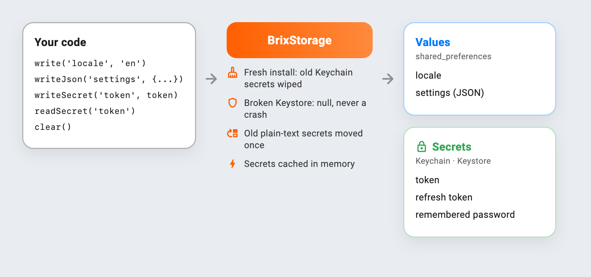

# brix_storage

[](https://pub.dev/packages/brix_cli)
[](https://pub.dev/packages/brix_ui)
[](https://pub.dev/packages/brix_getx)
[](https://pub.dev/packages/brix_network)
[](https://pub.dev/packages/brix_storage)
[](https://pub.dev/packages/brix)
[](https://github.com/mrubaz/brix/blob/main/LICENSE)

> Part of the [brix](https://github.com/mrubaz/brix) family. Starting a new app? `brix create my_app` from [brix_cli](https://pub.dev/packages/brix_cli) sets this package up for you. Adding it to an app you already have? It brings the core, [brix](https://pub.dev/packages/brix), with it.

Local storage that handles the tricky parts for you: plain values, secrets, and a ready session store for [brix](https://pub.dev/packages/brix).

Values go to `shared_preferences` and secrets to the Keychain or Keystore (through `flutter_secure_storage`), all behind one class.

It is safe after a reinstall. iOS keeps Keychain items when an app is deleted, so a new install could log in as the last user. brix_storage clears them on a fresh install.

It never crashes on a broken Keystore, which can happen on Android after a backup restore. The read simply returns `null` and the error goes to `onError`.

It moves old plain-text secrets into secure storage the first time they are read.

`BrixSessionStore` is a complete brix `AuthSessionStore`: tokens and the remembered password are kept as secrets and the user as JSON.



## Install

```
flutter pub add brix_storage
```

## Use

```dart
final storage = BrixStorage(onError: (error, stack) => log('storage: $error'));

await storage.write('locale', 'en');
await storage.writeJson('settings', {'darkMode': true});
await storage.writeSecret('token', token);   // Keychain / Keystore

final token = await storage.readSecret('token');      // cached in memory after the first read
final settings = await storage.readJson('settings');  // null if missing or broken

await storage.clear(); // everything, e.g. after deleting the account
```

### Session store for brix flows

```dart
final store = BrixSessionStore<User>(
  storage: storage,
  userToJson: (user) => user.toJson(),
  userFromJson: User.fromJson,
);

LoginFlow(provider: auth, store: store, navigator: nav, feedback: alerts);
```

| Call | Keeps |
|---|---|
| `clearSession()` (logout) | "remember me" |
| `clearAll()` (account deleted) | nothing |

Moving from your own storage? Pass the keys you used so users stay logged in:

```dart
BrixSessionStore<User>(
  storage: BrixStorage(installMarkerKey: 'hasSecureData'),
  keys: const SessionKeys(token: 'apiToken', user: 'user_data'),
  userToJson: (user) => user.toJson(),
  userFromJson: User.fromJson,
);
```

### Other backends

`ValueStore` and `SecretStore` are small interfaces: plug in Hive, a file, or `MemoryStore` in tests:

```dart
final storage = BrixStorage(values: MemoryStore(), secrets: MemoryStore());
```

## License

MIT

## The brix packages

brix_storage is one part of [brix](https://github.com/mrubaz/brix). New app? Start with [brix_cli](https://pub.dev/packages/brix_cli). Existing app? Take only the packages you need; each brings the core with it.

| Package | Version | What it does |
|---|---|---|
| [brix_cli](https://pub.dev/packages/brix_cli) | [](https://pub.dev/packages/brix_cli) | `brix create my_app`: a new app on every package below. Start here |
| [brix_ui](https://pub.dev/packages/brix_ui) | [](https://pub.dev/packages/brix_ui) | Buttons, fields, select, sheets, dialogs, toasts, light and dark |
| [brix_getx](https://pub.dev/packages/brix_getx) | [](https://pub.dev/packages/brix_getx) | GetX controllers for every account screen |
| [brix_network](https://pub.dev/packages/brix_network) | [](https://pub.dev/packages/brix_network) | REST calls that return a `Result` |
| [brix_storage](https://pub.dev/packages/brix_storage) | [](https://pub.dev/packages/brix_storage) | Values, secrets and a session store |
| [brix](https://pub.dev/packages/brix) | [](https://pub.dev/packages/brix) | The core every package builds on: flows, `Result`, `Json`, `BrixLogger` |
