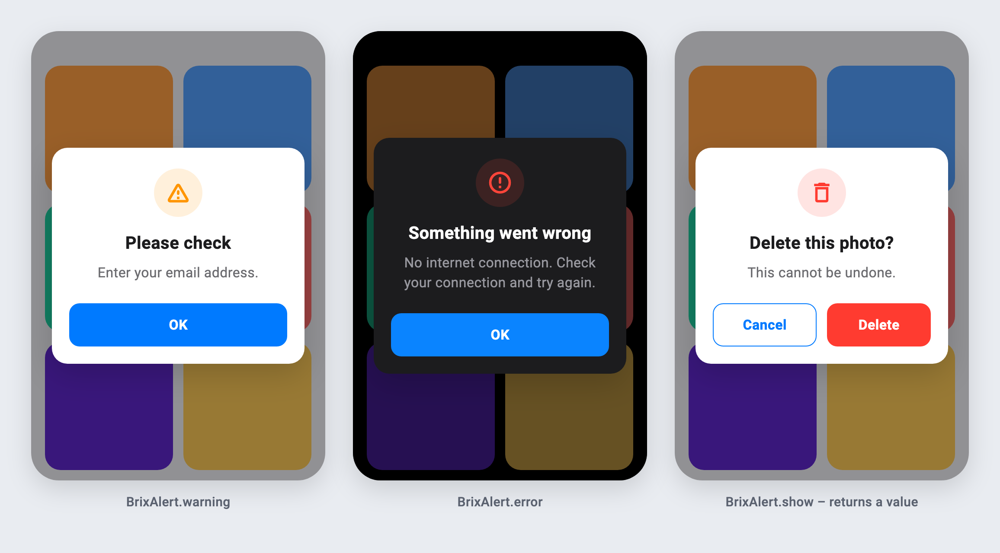
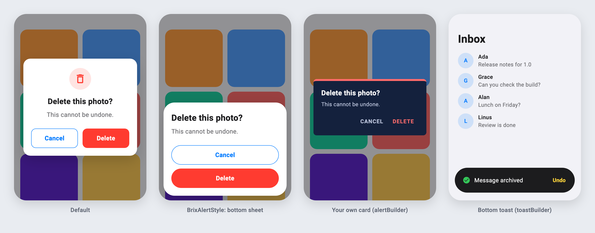
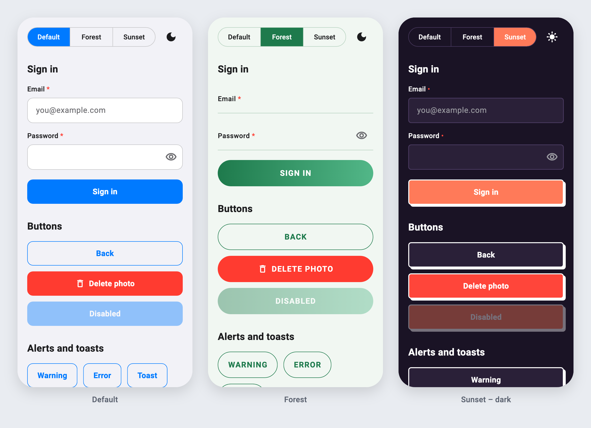

# brix_ui

[](https://pub.dev/packages/brix_ui)
[](https://github.com/mrubaz/brix/actions/workflows/ci.yml)
[](https://github.com/mrubaz/brix/blob/main/LICENSE)

**The basic widgets every app needs – in your colours, your font, your shape. Light and dark from day one.**

Buttons, text fields, a loader, alerts and toasts. They read everything from one theme, so the same code looks like *your* app – and switching to dark changes nothing in your widgets.


- 🎨 **Your look** – colours, font, corner radius, heights, texts and icons all come from `BrixTheme`. Nothing is hard-coded.
- 🌗 **Light and dark** – two themes, one widget tree. Theme changes animate.
- 🧠 **Logic included** – loading buttons ignore double taps, alerts open from a controller and return the tapped value, toasts hide themselves.
- 👀 **Readable everywhere** – alerts are a solid card on a dimmed screen, so they work on busy, colourful screens. Prefer glass? One switch.
- 🌍 **Any language** – every built-in text can be replaced.
- ♿ **Accessible** – 44 pt+ touch targets, labels read with their fields, toasts announced to screen readers.
- 🪶 **Light** – depends only on Flutter and [brix](https://pub.dev/packages/brix). No state library, no font or sizing package.

## Install

```
flutter pub add brix_ui
```

## Start

```dart
import 'package:brix_ui/brix_ui.dart';

const brand = Color(0xFF1E7A4C);

MaterialApp(
  navigatorKey: BrixUi.navigatorKey ??= GlobalKey(), // alerts from anywhere
  theme: BrixTheme.light(
    colors: const BrixColors.light(primary: brand),
    typography: BrixTypography(fontFamily: 'Inter'),
  ).toThemeData(),
  darkTheme: BrixTheme.dark(
    colors: const BrixColors.dark(primary: brand),
  ).toThemeData(),
  themeMode: ThemeMode.system,
);
```

- Using GetX? `BrixUi.navigatorKey = Get.key;`
- Already have a `ThemeData`? Add the tokens to it: `ThemeData(extensions: [BrixTheme.light()])`.
- No theme at all? The widgets still work, with iOS-like defaults for the app's brightness.


## Buttons

```dart
BrixButton(label: 'Log in', isLoading: loading, onPressed: login)
BrixButton(label: 'Continue', gradient: true, onPressed: next)
BrixButton.outlined(label: 'Back', onPressed: back)
BrixButton.destructive(label: 'Delete account', icon: Icons.delete_outline, onPressed: delete)
```

- While loading it keeps its size and ignores taps, so a request is never sent twice.
- `onPressed: null` disables it.
- A light haptic and a small press scale (turn haptics off with `haptics: false`).
- Full width by default (forms); `expand: false` fits the label.


## Text fields

```dart
AutofillGroup(
  child: Column(children: [
    BrixTextField(
      controller: email,
      label: 'Email',
      isRequired: true,
      keyboardType: TextInputType.emailAddress,
      autofillHints: const [AutofillHints.email],
      textInputAction: TextInputAction.next,
    ),
    BrixTextField(
      controller: password,
      label: 'Password',
      isRequired: true,
      isPassword: true,
      autofillHints: const [AutofillHints.password],
      onSubmitted: (_) => login(),
    ),
  ]),
)
```

- **Required:** a `*` on the label; inside a `Form`, an empty check when you give no `validator`.
- **Password:** show / hide button, no autocorrect, the value is never trimmed.
- **Keyboard:** Next moves to the next field; Done or a tap outside closes the keyboard.
- **Errors:** your `validator`, or `errorText` from outside (e.g. the backend's field error).
- **Read-only / disabled** have their own look (a read-only field can open a picker on tap).


## Alerts

```dart
BrixAlert.warning('Enter your email address.');
BrixAlert.error('No internet connection.');

final delete = await BrixAlert.show<bool>(
  title: 'Delete this photo?',
  message: 'This cannot be undone.',
  icon: const BrixIcon(Icons.delete_outline),
  buttons: const [
    BrixAlertButton(label: 'Cancel', value: false),
    BrixAlertButton.destructive(label: 'Delete', value: true),
  ],
);
```

- `warning` / `error` open from anywhere (a controller too), stay on top while the screen underneath changes, and a new one replaces the open one.
- `show` returns the tapped button's value. Two buttons sit side by side, more are stacked.
- Long messages scroll; the screen below cannot be tapped.



## Toasts

```dart
BrixToast.success('Profile saved');
BrixToast.success('We sent a code to ada@brix.dev', title: 'Check your email');
```

Slides in at the top, hides after 3 seconds (or on tap / swipe up), never blocks the screen, and screen readers announce it.


## Make it yours

Everything has a default – change only what you need.

| What | How |
|---|---|
| Colours | `BrixColors.light(primary: …, background: …, danger: …)` and `BrixColors.dark(…)` |
| Font and text sizes | `BrixTypography(fontFamily: 'Inter')`, or whole styles: `BrixTypography(title: GoogleFonts.poppins(fontSize: 22))` |
| Corners and sizes | `BrixShape(radius: 26, buttonHeight: 54, fieldHeight: 54, borderWidth: 1.5)` |
| Texts (any language) | `BrixUiTexts(ok: 'ٹھیک ہے', errorTitle: 'خرابی', requiredField: '…')` |
| Icons (any set, SVG too) | `BrixUiIcons(success: BrixIcon(CupertinoIcons.check_mark_circled), error: BrixIcon.custom(svg))` |
| Frosted glass alerts and toasts | `BrixTheme.light(glass: true)` |
| Every button's look | `BrixButtonStyle(radius: 40, height: 56, upperCase: true, gradient: true, pressedScale: 1, …)` |
| A completely own button | `buttonBuilder: (context, button) => MyButton(...)` – brix keeps the logic |
| Every field's look | `BrixTextFieldStyle(border: BrixFieldBorder.underline, labelInside: true, radius: 24, fillColor: …)` |
| A completely own field | `textFieldBuilder: (context, field) => MyField(...)` – brix keeps the logic |
| Every alert's place and look | `BrixAlertStyle(alignment: Alignment.bottomCenter, transition: BrixAlertTransition.slideUp, maxWidth: 300, showIcon: false, buttonsVertical: true, …)` |
| A completely own alert card | `alertBuilder: (context, alert) => MyCard(...)` – brix keeps the dimmed screen and the returned value |
| Toast place, time and look | `BrixToastStyle(position: BrixToastPosition.bottom, duration: Duration(seconds: 2), animationDuration: …, …)` – top, centre or bottom |
| A completely own toast | `toastBuilder: (context, toast) => MyToast(...)` – brix keeps the timer and swiping |
| Spinner | `BrixLoaderStyle(radius: 14, color: …)`, or `loaderBuilder: (context, loader) => MySpinner(...)` – loading buttons use it too |
| Button animation speed | `BrixButtonStyle(pressDuration: …, fadeDuration: …)` |
| Required marker and errors | `BrixTextFieldStyle(requiredMarker: ' (required)', requiredMarkerStyle: …, errorStyle: …, errorMaxLines: 2)` |
| Dimmed screen behind alerts | `BrixAlertStyle(scrimColor: …)` – transparent to keep the screen as it is |

```dart
BrixTheme.light(
  colors: const BrixColors.light(primary: Color(0xFF1E7A4C)),
  shape: const BrixShape(radius: 26),
  texts: const BrixUiTexts(ok: 'ٹھیک ہے'),
  icons: BrixUiIcons(error: BrixIcon.custom(SvgPicture.asset('assets/error.svg'))),
)
```

### Buttons your way

Three levels – use the one you need:

```dart
// 1. Every button in the app.
BrixTheme.light(
  button: const BrixButtonStyle(radius: 40, height: 56, upperCase: true, gradient: true),
)

// 2. One button.
BrixButton(label: 'Skip', style: const BrixButtonStyle(height: 40), onPressed: skip)

// 3. Your own widget – brix still blocks double taps, plays the haptic and
//    disables it while loading.
BrixTheme.light(
  buttonBuilder: (context, button) => MyButton(
    label: button.label,
    danger: button.variant == BrixButtonVariant.destructive,
    busy: button.isLoading,
    onTap: button.onPressed, // null while loading or disabled
  ),
)
```

Alerts use your button too, so the whole app matches.


### Text fields your way

The same three levels:

```dart
// 1. Every field: outline (default), underline or none; label above or inside.
BrixTheme.light(
  textField: const BrixTextFieldStyle(border: BrixFieldBorder.underline, labelInside: true),
)

// 2. One field.
BrixTextField(label: 'Notes', maxLines: 4, style: const BrixTextFieldStyle(radius: 20))

// 3. Your own widget – pass brix's values to your TextFormField and the
//    required check, password show / hide and Next / Done keep working.
BrixTheme.light(
  textFieldBuilder: (context, field) => TextFormField(
    controller: field.controller,
    focusNode: field.focusNode,
    validator: field.validator,
    obscureText: field.obscureText,
    textInputAction: field.textInputAction,
    onEditingComplete: field.onEditingComplete,
    onTapOutside: field.onTapOutside,
    decoration: MyDecoration(label: field.label, onEye: field.toggleObscured),
  ),
)
```


### Alerts and toasts your way

```dart
BrixTheme.light(
  // Anywhere on the screen: centre (default), a bottom sheet, a top banner.
  alert: const BrixAlertStyle(
    alignment: Alignment.bottomCenter,
    transition: BrixAlertTransition.slideUp, // scale, fade, slideUp, slideDown
    margin: EdgeInsets.all(12),
    showIcon: false,
    textAlign: TextAlign.start,
    buttonsVertical: true,
  ),
  toast: const BrixToastStyle(position: BrixToastPosition.bottom),

  // Your own cards – brix still dims the screen, animates, returns the
  // tapped value, runs the toast timer and handles swipes.
  alertBuilder: (context, alert) => MyAlertCard(
    title: alert.title,
    message: alert.message,
    actions: [
      for (final button in alert.buttons)
        MyAction(button.label, onTap: () => alert.onPressed(button.value)),
    ],
  ),
  toastBuilder: (context, toast) => MySnack(toast.message, onUndo: toast.dismiss),
)
```

One alert only: `BrixAlert.show(style: …, builder: …)`.



Read the tokens in your own widgets too, so they match:

```dart
final brix = context.brix;
Text('Hello', style: brix.typography.body.copyWith(color: brix.colors.text));
```

## With brix auth

`BrixUiFeedback` is a ready [brix](https://pub.dev/packages/brix) `AuthFeedback` – failures and warnings as alerts, success messages as a toast. No adapter to write:

```dart
LoginFlow(
  provider: MyAuth(),
  store: store,
  navigator: MyNavigator(),
  feedback: const BrixUiFeedback(),
)
```

When the backend sends no message (e.g. no connection), brix's default text is shown, so an alert is never empty.

## Example

[`example/`](example) is every widget on one screen – switch light / dark and three brands live. Default is brix's own look; Forest uses only style settings (pill gradient buttons, underlined fields, bottom-sheet alerts, bottom toasts); Sunset draws its own buttons and toasts with builders, uses frosted glass and Urdu texts. See [`example/lib/brands.dart`](example/lib/brands.dart).



## Screenshots

The images on this page are rendered from the real widgets by `tool/screenshots_test.dart`:

```
flutter test tool/screenshots_test.dart --update-goldens            # widgets
cd example && flutter test tool/screenshots_test.dart --update-goldens  # example screen
```

## More brix

brix_ui is part of [brix](https://github.com/mrubaz/brix) – auth, account, network, storage and GetX blocks that work together, each its own package.

MIT licensed.
