# brix_ui

[](https://pub.dev/packages/brix_ui)
[](https://github.com/mrubaz/brix/actions/workflows/ci.yml)
[](https://github.com/mrubaz/brix/blob/main/LICENSE)

Buttons, text fields, a loader, dialogs and toasts that look like your app. They take every colour, font and size from one theme, so switching to dark mode changes nothing in your screens.

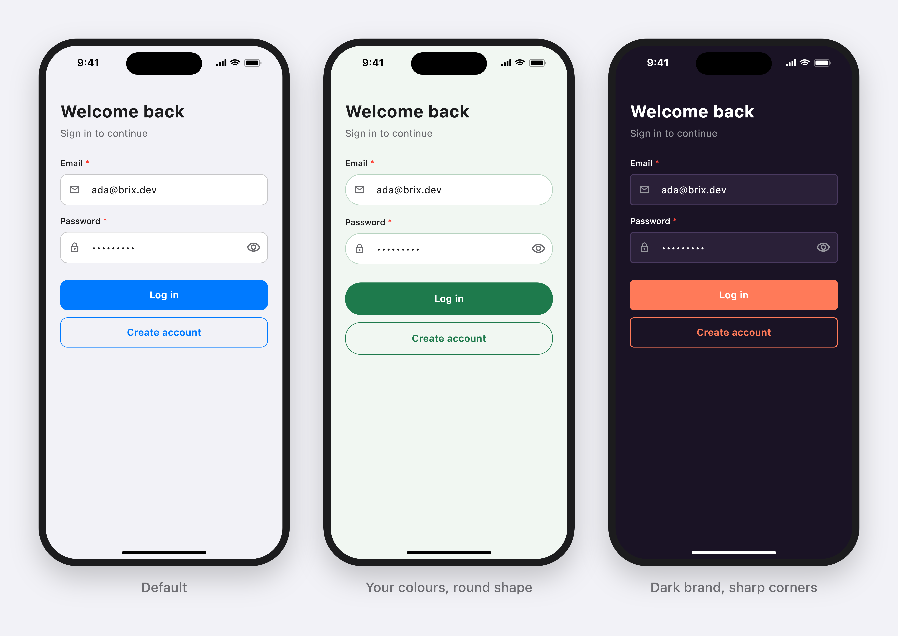

What you get:

- Your look. Colours, font, corners, heights, texts and icons all come from `BrixTheme`. Nothing is fixed in the widgets.
- Light and dark from the start. Theme changes animate.
- The small logic is done. A loading button ignores extra taps, a dialog opens from a controller and tells you which button was tapped, a toast hides by itself.
- Dialogs you can read on any screen. They are a solid card on a dimmed background. If you like frosted glass, it is one setting.
- Any language. Every text the kit shows on its own can be replaced.
- Accessible. Touch targets are at least 44 points, labels are read with their fields and toasts are announced to screen readers.
- Light on dependencies. Only Flutter and [brix](https://pub.dev/packages/brix), no state library and no font or sizing package.

## Install

```
flutter pub add brix_ui
```

## Start

```dart
import 'package:brix_ui/brix_ui.dart';

const brand = Color(0xFF1E7A4C);

MaterialApp(
  navigatorKey: BrixUi.navigatorKey ??= GlobalKey(), // dialogs from anywhere
  theme: BrixTheme.light(
    colors: const BrixColors.light(primary: brand),
    typography: BrixTypography(fontFamily: 'Inter'),
  ).toThemeData(),
  darkTheme: BrixTheme.dark(
    colors: const BrixColors.dark(primary: brand),
  ).toThemeData(),
  themeMode: ThemeMode.system,
);
```

- Using GetX? `BrixUi.navigatorKey = Get.key;`
- Already have a `ThemeData`? Add the tokens to it: `ThemeData(extensions: [BrixTheme.light()])`.
- No theme at all? The widgets still work, with iOS-like defaults for the app's brightness.

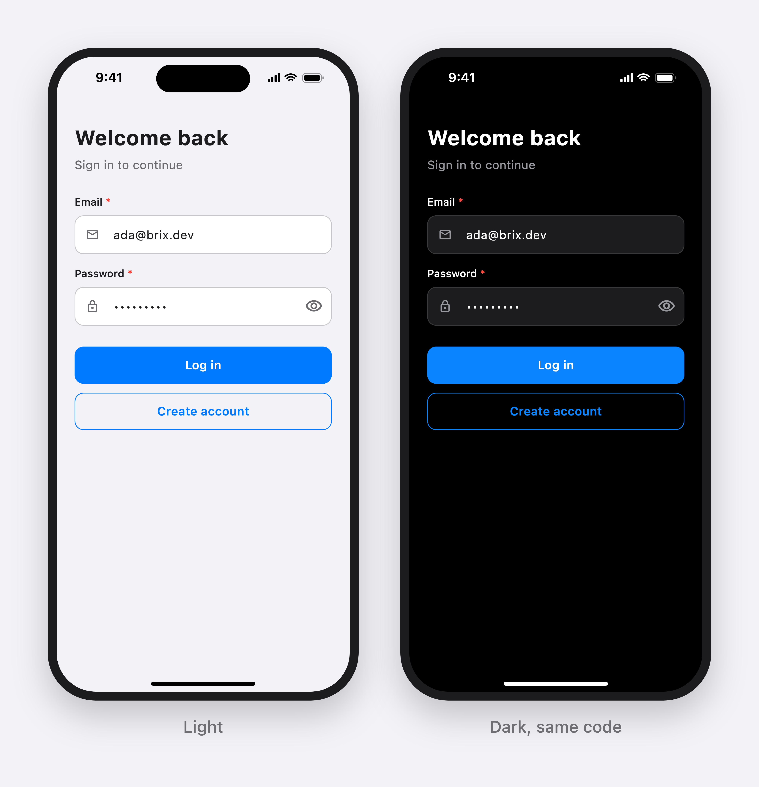

## Buttons

```dart
BrixButton(label: 'Log in', isLoading: loading, onPressed: login)
BrixButton(label: 'Continue', gradient: true, onPressed: next)
BrixButton.outlined(label: 'Back', onPressed: back)
BrixButton.destructive(label: 'Delete account', icon: Icons.delete_outline, onPressed: delete)
```

- While loading it keeps its size and ignores taps, so a request is never sent twice.
- `onPressed: null` disables it.
- A light haptic and a small press scale (turn haptics off with `haptics: false`).
- Full width by default (forms); `expand: false` fits the label.

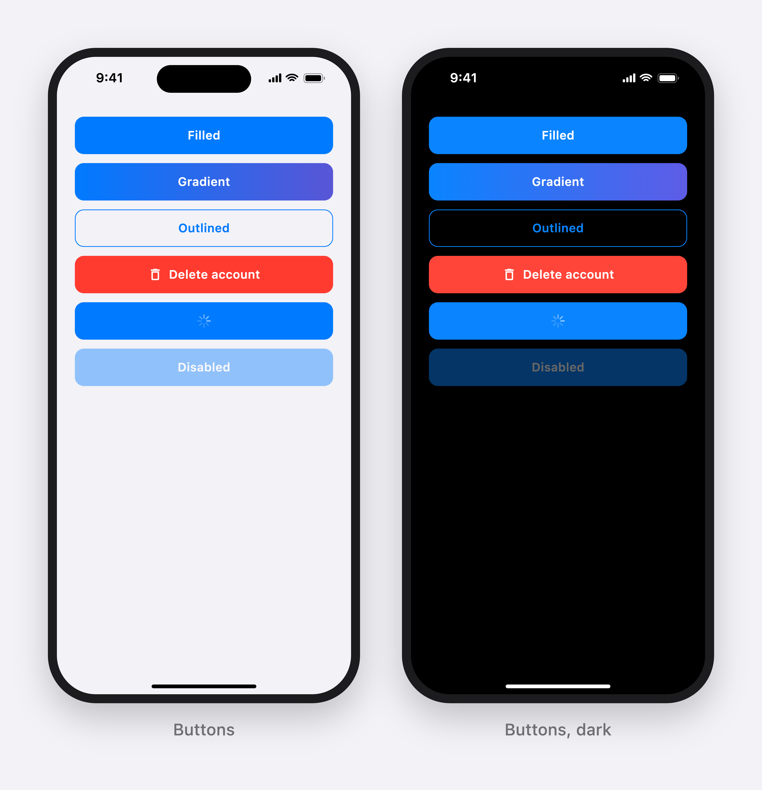

## Text fields

```dart
AutofillGroup(
  child: Column(children: [
    BrixTextField(
      controller: email,
      label: 'Email',
      isRequired: true,
      keyboardType: TextInputType.emailAddress,
      autofillHints: const [AutofillHints.email],
      textInputAction: TextInputAction.next,
    ),
    BrixTextField(
      controller: password,
      label: 'Password',
      isRequired: true,
      isPassword: true,
      autofillHints: const [AutofillHints.password],
      onSubmitted: (_) => login(),
    ),
  ]),
)
```

- **Required:** a `*` on the label; inside a `Form`, an empty check when you give no `validator`.
- **Password:** show / hide button, no autocorrect, the value is never trimmed.
- **Keyboard:** Next moves to the next field; Done or a tap outside closes the keyboard.
- **Errors:** your `validator`, or `errorText` from outside (e.g. the backend's field error).
- **Read-only / disabled** have their own look (a read-only field can open a picker on tap).

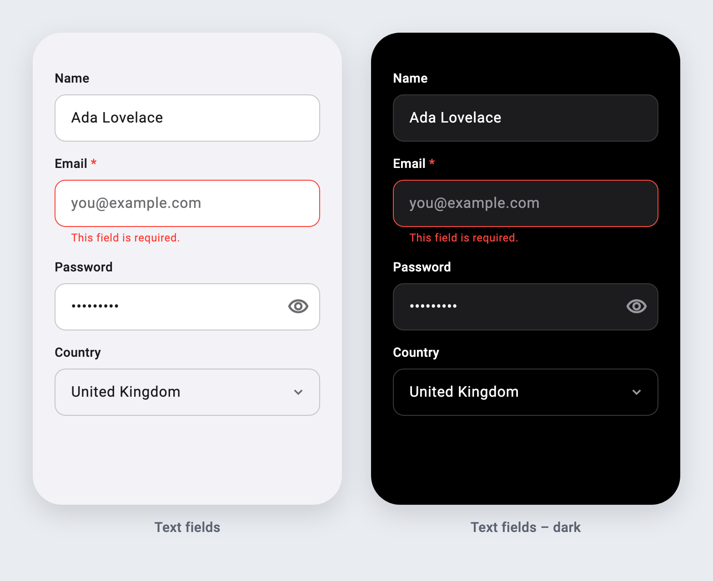

## Dialogs

```dart
BrixDialog.warning('Enter your email address.');
BrixDialog.error('No internet connection.');

final delete = await BrixDialog.show<bool>(
  title: 'Delete this photo?',
  message: 'This cannot be undone.',
  icon: const BrixIcon(Icons.delete_outline),
  buttons: const [
    BrixDialogButton(label: 'Cancel', value: false),
    BrixDialogButton.destructive(label: 'Delete', value: true),
  ],
);
```

- `warning` / `error` open from anywhere (a controller too), stay on top while the screen underneath changes, and a new one replaces the open one.
- `show` returns the tapped button's value. Two buttons sit side by side, more are stacked.
- Long messages scroll; the screen below cannot be tapped.

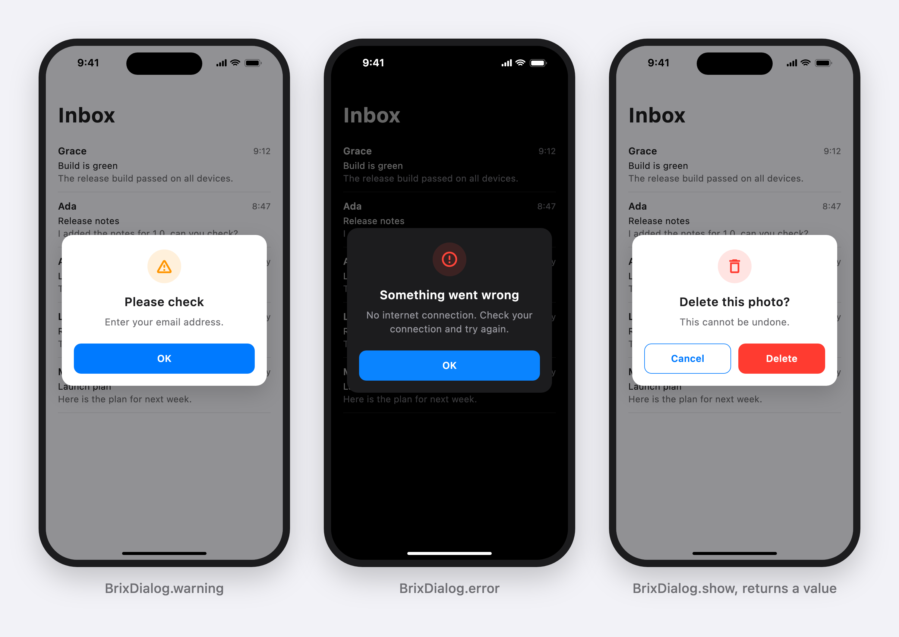

## Dialog, sheet or toast?

- A dialog sits in the middle of the screen and asks one clear question: "Delete this photo?". The screen behind is dimmed until a button is tapped.
- A sheet slides up from the bottom and holds more: a list of choices, a short form, a few actions. People drag it down to close it.
- A toast is a short note that something worked. It hides by itself and never blocks the screen.

## Sheets

```dart
final folder = await BrixSheet.show<String>(
  title: 'Move to',
  builder: (context) => Column(children: [
    ListTile(
      title: const Text('Archive'),
      onTap: () => BrixSheet.close(context, 'archive'),
    ),
    ListTile(
      title: const Text('Trash'),
      onTap: () => BrixSheet.close(context, 'trash'),
    ),
  ]),
);
```

- It opens as tall as its content, or at half or full height with `height: BrixSheetHeight.half`.
- Drag it down or tap outside to close it; `dismissible: false` keeps it open until your code closes it.
- `show` returns the value you close it with, or `null` when it was dragged away.

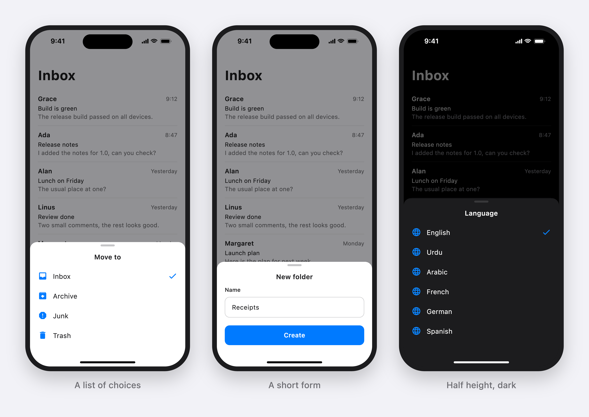

## Select

A dropdown that matches your text fields. Up to six options open in a menu under the field, more open in a sheet with a list.

```dart
BrixSelect<String>(
  label: 'Country',
  isRequired: true,
  value: country,
  options: const [
    BrixOption(value: 'pk', label: 'Pakistan'),
    BrixOption(value: 'gb', label: 'United Kingdom'),
  ],
  onChanged: (value) => setState(() => country = value),
)
```

- It is typed: `BrixSelect<Country>` gives you a `Country` back.
- Inside a `Form`, a required select checks that something is chosen.
- `mode: BrixSelectMode.menu` or `.sheet` picks the way it opens yourself.

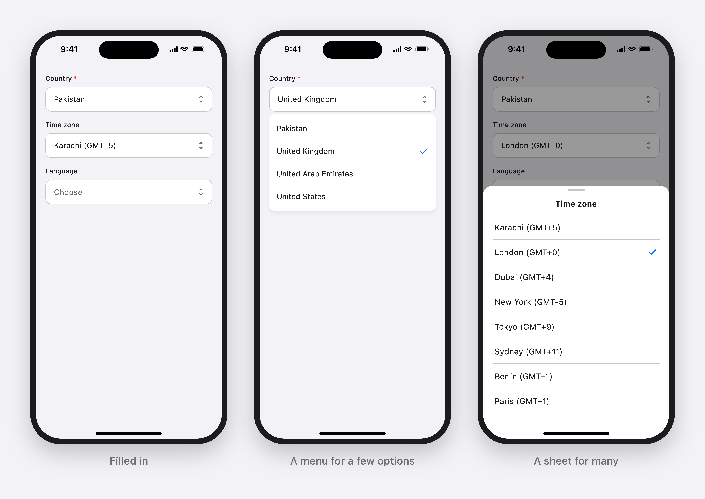

## Toasts

```dart
BrixToast.success('Profile saved');
BrixToast.success('We sent a code to ada@brix.dev', title: 'Check your email');
```

Slides in at the top, hides after 3 seconds (or on tap / swipe up), never blocks the screen, and screen readers announce it.

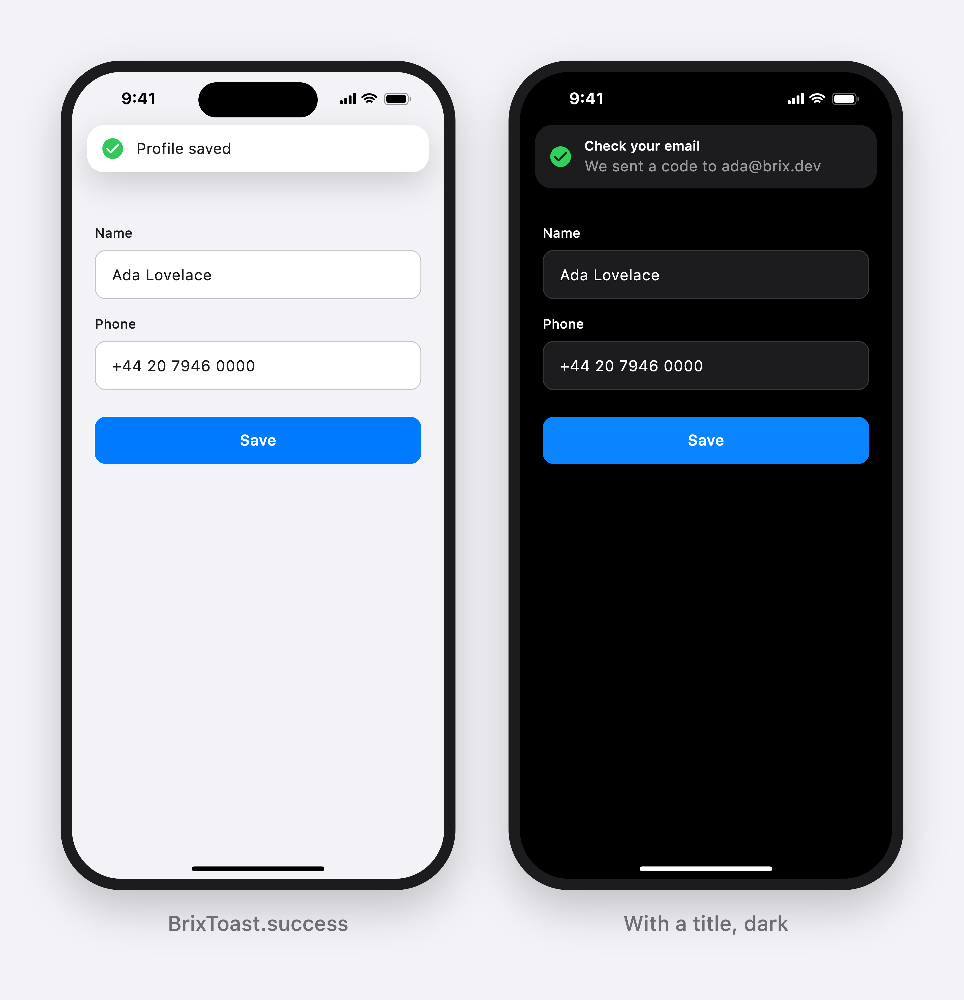

## Make it yours

Everything has a default. Change only what you need.

| What | How |
|---|---|
| Colours | `BrixColors.light(primary: ..., background: ..., danger: ...)` and `BrixColors.dark(...)` |
| Font and text sizes | `BrixTypography(fontFamily: 'Inter')`, or whole styles: `BrixTypography(title: GoogleFonts.poppins(fontSize: 22))` |
| Corners and sizes | `BrixShape(radius: 26, buttonHeight: 54, fieldHeight: 54, borderWidth: 1.5)` |
| Texts (any language) | `BrixUiTexts(ok: 'ٹھیک ہے', errorTitle: 'خرابی', requiredField: '...')` |
| Icons (any set, SVG too) | `BrixUiIcons(success: BrixIcon(CupertinoIcons.check_mark_circled), error: BrixIcon.custom(svg))` |
| Frosted glass dialogs and toasts | `BrixTheme.light(glass: true)` |
| Every button's look | `BrixButtonStyle(radius: 40, height: 56, upperCase: true, gradient: true, pressedScale: 1, ...)` |
| A completely own button | `buttonBuilder: (context, button) => MyButton(...)`, brix keeps the logic |
| Every field's look | `BrixTextFieldStyle(border: BrixFieldBorder.underline, labelInside: true, radius: 24, fillColor: ...)` |
| A completely own field | `textFieldBuilder: (context, field) => MyField(...)`, brix keeps the logic |
| Every dialog's place and look | `BrixDialogStyle(alignment: Alignment.bottomCenter, transition: BrixDialogTransition.slideUp, maxWidth: 300, showIcon: false, buttonsVertical: true, ...)` |
| A completely own dialog card | `dialogBuilder: (context, dialog) => MyCard(...)`, brix keeps the dimmed screen and the returned value |
| Toast place, time and look | `BrixToastStyle(position: BrixToastPosition.bottom, duration: Duration(seconds: 2), animationDuration: ..., ...)`, top, centre or bottom |
| A completely own toast | `toastBuilder: (context, toast) => MyToast(...)`, brix keeps the timer and swiping |
| Sheets | `BrixSheetStyle(radius: 16, showGrabber: false, backgroundColor: ...)`, or `sheetBuilder: (context, sheet) => MySheet(...)` |
| Select menus and sheets | `BrixSelectStyle(menuRadius: 14, selectedColor: ...)`, or `selectBuilder: (context, select) => MyPicker(...)`; the field follows your text field style |
| Spinner | `BrixLoaderStyle(radius: 14, color: ...)`, or `loaderBuilder: (context, loader) => MySpinner(...)`, loading buttons use it too |
| Button animation speed | `BrixButtonStyle(pressDuration: ..., fadeDuration: ...)` |
| Required marker and errors | `BrixTextFieldStyle(requiredMarker: ' (required)', requiredMarkerStyle: ..., errorStyle: ..., errorMaxLines: 2)` |
| Dimmed screen behind dialogs | `BrixDialogStyle(scrimColor: ...)`, transparent to keep the screen as it is |

```dart
BrixTheme.light(
  colors: const BrixColors.light(primary: Color(0xFF1E7A4C)),
  shape: const BrixShape(radius: 26),
  texts: const BrixUiTexts(ok: 'ٹھیک ہے'),
  icons: BrixUiIcons(error: BrixIcon.custom(SvgPicture.asset('assets/error.svg'))),
)
```

### Buttons your way

Three levels: use the one you need:

```dart
// 1. Every button in the app.
BrixTheme.light(
  button: const BrixButtonStyle(radius: 40, height: 56, upperCase: true, gradient: true),
)

// 2. One button.
BrixButton(label: 'Skip', style: const BrixButtonStyle(height: 40), onPressed: skip)

// 3. Your own widget. brix still blocks double taps, plays the haptic and
//    disables it while loading.
BrixTheme.light(
  buttonBuilder: (context, button) => MyButton(
    label: button.label,
    danger: button.variant == BrixButtonVariant.destructive,
    busy: button.isLoading,
    onTap: button.onPressed, // null while loading or disabled
  ),
)
```

Dialogs use your button too, so the whole app matches.

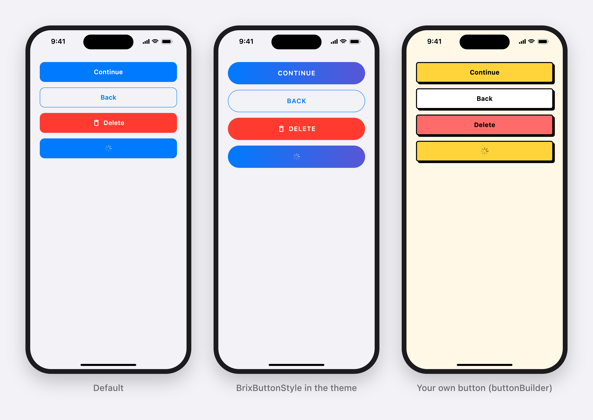

### Text fields your way

The same three levels:

```dart
// 1. Every field: outline (default), underline or none; label above or inside.
BrixTheme.light(
  textField: const BrixTextFieldStyle(border: BrixFieldBorder.underline, labelInside: true),
)

// 2. One field.
BrixTextField(label: 'Notes', maxLines: 4, style: const BrixTextFieldStyle(radius: 20))

// 3. Your own widget. Pass brix's values to your TextFormField and the
//    required check, password show / hide and Next / Done keep working.
BrixTheme.light(
  textFieldBuilder: (context, field) => TextFormField(
    controller: field.controller,
    focusNode: field.focusNode,
    validator: field.validator,
    obscureText: field.obscureText,
    textInputAction: field.textInputAction,
    onEditingComplete: field.onEditingComplete,
    onTapOutside: field.onTapOutside,
    decoration: MyDecoration(label: field.label, onEye: field.toggleObscured),
  ),
)
```

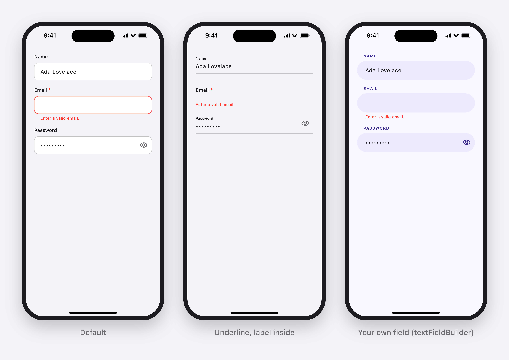

### Dialogs and toasts your way

```dart
BrixTheme.light(
  // Anywhere on the screen: centre (default), a bottom sheet, a top banner.
  dialog: const BrixDialogStyle(
    alignment: Alignment.bottomCenter,
    transition: BrixDialogTransition.slideUp, // scale, fade, slideUp, slideDown
    margin: EdgeInsets.all(12),
    showIcon: false,
    textAlign: TextAlign.start,
    buttonsVertical: true,
  ),
  toast: const BrixToastStyle(position: BrixToastPosition.bottom),

  // Your own cards. brix still dims the screen, animates, returns the
  // tapped value, runs the toast timer and handles swipes.
  dialogBuilder: (context, dialog) => MyDialogCard(
    title: dialog.title,
    message: dialog.message,
    actions: [
      for (final button in dialog.buttons)
        MyAction(button.label, onTap: () => dialog.onPressed(button.value)),
    ],
  ),
  toastBuilder: (context, toast) => MySnack(toast.message, onUndo: toast.dismiss),
)
```

One dialog only: `BrixDialog.show(style: ..., builder: ...)`.

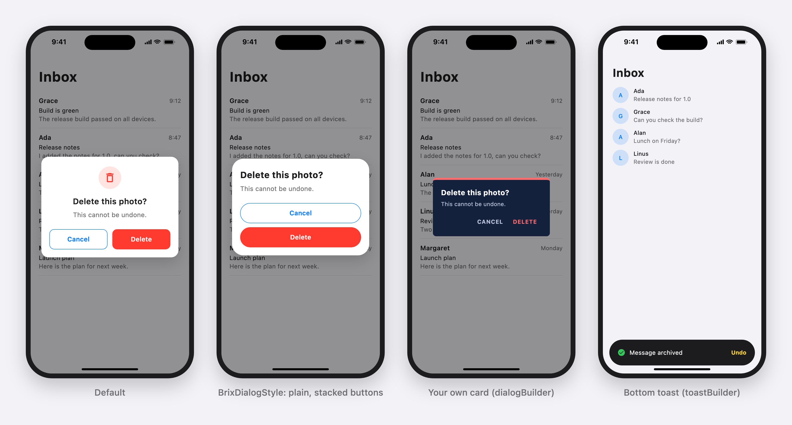

Read the tokens in your own widgets too, so they match:

```dart
final brix = context.brix;
Text('Hello', style: brix.typography.body.copyWith(color: brix.colors.text));
```

## With brix auth

`BrixUiFeedback` is a ready [brix](https://pub.dev/packages/brix) `AuthFeedback`: failures and warnings as dialogs, success messages as a toast. No adapter to write:

```dart
LoginFlow(
  provider: MyAuth(),
  store: store,
  navigator: MyNavigator(),
  feedback: const BrixUiFeedback(),
)
```

When the backend sends no message (e.g. no connection), brix's default text is shown, so a dialog is never empty.

## Example

[`example/`](example) shows every widget on one screen. Switch light and dark and three brands live; see [`example/lib/brands.dart`](example/lib/brands.dart) for how each brand is set up.

## Screenshots

The images on this page are rendered from the real widgets by `tool/screenshots_test.dart`:

```
flutter test tool/screenshots_test.dart --update-goldens            # widgets
```

## More brix

brix_ui is part of [brix](https://github.com/mrubaz/brix): auth, account, network, storage and GetX blocks that work together, each its own package.

MIT licensed.
